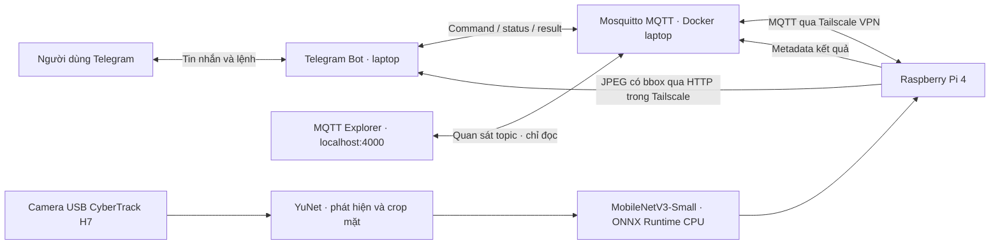

# EdgeFace — Kiến trúc MVP

**Mục tiêu hiện tại:** nhận diện Dung, Hùng, Nguyễn Hồ Trường Sơn, Thanh, Tuấn hoặc `Unknown` trực tiếp trên Raspberry Pi, điều khiển và nhận kết quả qua Telegram. Chưa bật âm thanh; đã chạy thu thập 150 ảnh Sơn bằng camera Pi qua MQTT.

## Phân công giữa laptop và Pi

| Laptop | Raspberry Pi |
|---|---|
| Chạy Telegram bot bằng long polling và MQTT broker có mật khẩu/ACL | Đọc camera khi nhận `/start`, đóng camera khi `/stop` |
| Tách frame từ video thành viên, dùng YuNet crop mặt | Phát hiện mặt, tiền xử lý RGB 224×224 và inference ONNX tại Pi |
| Fine-tune MobileNetV3-Small pretrained ImageNet bằng GPU RTX 2050 | Trả tên thành viên/Unknown, confidence, latency và telemetry |
| Chọn threshold bằng validation, đánh giá và export ONNX | Có cooldown thông báo, reconnect MQTT và báo lỗi camera/model |

MQTT chỉ truyền JSON: command, status, result, telemetry và collection. **Không truyền video/frame và không suy luận trên laptop trong lúc demo.**

Khi nhận diện known, bot gửi tin nhắn kết quả và một ảnh thành **hai tin riêng** về chat đã `/start`. Pi vẽ bbox, tên tiếng Việt và confidence trên đúng frame nhận diện; bot tải JPEG qua HTTP/Tailscale có token, không qua MQTT. Cache ảnh chỉ ở RAM Pi và tự hết hạn sau 120 giây. Unknown không gửi chữ/ảnh; camera auto-stop như trước. [Chi tiết](PHOTO_NOTIFICATIONS.md).

## Luồng dữ liệu và model

`Video thành viên → YuNet crop mặt → lọc chất lượng/trùng lặp → chia tập → fine-tune → chọn threshold → kiểm tra ONNX → deploy Pi`.

- Model hiện tại fine-tune tiếp từ bản team ImageNet với 6 video của 5 thành viên và ảnh camera Sơn, classifier 6 lớp; release `5010dc47644c`. Unknown lấy ảnh thật từ 60 danh tính LFW công khai, lưu nguồn/checksum và tách riêng danh tính giữa train/validation/test.
- Video điện thoại được xoay đúng hướng trước khi detect/crop. Các tập thành viên chia theo đoạn thời gian có khoảng bỏ trống; vẫn dùng chung nguồn quay nên chưa chứng minh độ chính xác ở phiên mới. [Kết quả và giới hạn đánh giá](../report/TEAM_TRAINING_20261020.md).
- Model xuất kèm `classes.json`, `preprocessing.json` và `threshold.json`. Pi dùng cùng preprocessing với training; dự đoán lớp Unknown hoặc confidence thấp hơn threshold sẽ trả `Unknown`.

## Điều khiển và triển khai

- Lệnh MVP: `/start`, `/stop`, `/status`, `/members`, `/help`. `/start` hiển thị “Đang nhận diện...”; thành viên thì gửi kết quả và tự stop, Unknown không gửi tin nhắn và tiếp tục. Tên hiển thị của 5 thành viên nằm trong `configs/display_names.json`.
- Laptop: Docker Compose chạy Mosquitto, bot và MQTT Explorer để xem topic trực tiếp trên trình duyệt. Pi: Python native, ONNX Runtime CPU; triển khai bằng SSH và systemd.
- Pi dùng DHCP trên Wi-Fi; profile IP tĩnh cũ đã tắt autoconnect. Truy cập bằng IP Tailscale để không phụ thuộc địa chỉ LAN của từng mạng.
- Tailscale native tự chạy trên WSL/Pi: WSL `100.73.104.13`, Pi `100.83.132.53`. Pi kết nối WSL:1883 qua VPN; Tailscale Serve chuyển TCP vào broker loopback. SSH tunnel cũ đã tắt. Windows có tác vụ tự mở và giữ WSL khi đăng nhập.
- Secrets nằm trong `.env`, không đưa vào Git. Theo lựa chọn MVP, hai allowlist Telegram để trống; bot nhận lệnh từ mọi chat và gửi kết quả về chat đã kích hoạt nhận diện.

## Trạng thái và việc tiếp theo

Đã train và đánh giá classifier 5 thành viên + Unknown, kiểm tra PyTorch/ONNX và đối chiếu 181 crop test trên Pi, kích hoạt release mới, sửa RGB/BGR khi camera USB trả MJPEG, kiểm tra camera thật và MQTT members/status. Bot đã cập nhật tên hiển thị; logic Unknown im lặng và auto-stop giữ nguyên. Đánh giá phiên quay độc lập và benchmark camera dài hạn còn cần bổ sung. Chi tiết kết nối: [TAILSCALE.md](TAILSCALE.md).

**Giới hạn:** chưa có liveness detection; ảnh in/màn hình có thể đánh lừa hệ thống. Ảnh Unknown trên mạng khác điều kiện camera thực tế; cần test thêm với người lạ đồng ý tham gia và video thành viên ở phiên độc lập. Đã bổ sung dữ liệu IoT camera của Sơn; các thành viên khác vẫn cần các phiên Pi và test độc lập. [Chi tiết cập nhật camera](../report/SON_CAMERA_UPDATE_20261020.md).
