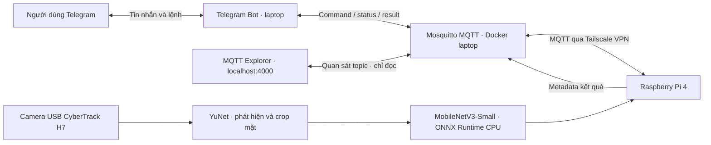

# EdgeFace — Kiến trúc MVP

**Mục tiêu hiện tại:** nhận diện `son` hoặc `Unknown` trực tiếp trên Raspberry Pi, điều khiển và nhận kết quả qua Telegram. Chưa bật âm thanh; thu thập ảnh qua Telegram để sau MVP.

## Phân công giữa laptop và Pi

| Laptop | Raspberry Pi |
|---|---|
| Chạy Telegram bot bằng long polling và MQTT broker có mật khẩu/ACL | Đọc camera khi nhận `/start`, đóng camera khi `/stop` |
| Tách frame từ video thành viên, dùng YuNet crop mặt | Phát hiện mặt, tiền xử lý RGB 224×224 và inference ONNX tại Pi |
| Fine-tune MobileNetV3-Small pretrained ImageNet bằng GPU RTX 2050 | Trả tên thành viên/Unknown, confidence, latency và telemetry |
| Chọn threshold bằng validation, đánh giá và export ONNX | Có cooldown thông báo, reconnect MQTT và báo lỗi camera/model |

MQTT chỉ truyền JSON: command, status, result, telemetry và collection. **Không truyền video/frame và không suy luận trên laptop trong lúc demo.**

## Luồng dữ liệu và model

`Video thành viên → YuNet crop mặt → lọc chất lượng/trùng lặp → chia tập → fine-tune → chọn threshold → kiểm tra ONNX → deploy Pi`.

- Model hiện tại train tiếp từ checkpoint trước với hai video `dataset/videos/son/1.mp4` và `2.mp4`; video mới đóng góp 338 crop hợp lệ. Unknown lấy ảnh thật từ LFW công khai, lưu nguồn và checksum; danh tính Unknown được tách riêng giữa train/validation/test.
- Hai video thành viên được chia theo đoạn thời gian có khoảng bỏ trống. Train/validation/test vẫn dùng chung nguồn quay nên chưa chứng minh độ chính xác ở phiên mới. [Phương pháp và giới hạn đánh giá](../report/ARCHITECTURE_AND_METHODS.md).
- Model xuất kèm `classes.json`, `preprocessing.json` và `threshold.json`. Pi dùng cùng preprocessing với training; dự đoán lớp Unknown hoặc confidence thấp hơn threshold sẽ trả `Unknown`.

## Điều khiển và triển khai

- Lệnh MVP: `/start`, `/stop`, `/status`, `/members`, `/help`. `/start` hiển thị “Đang nhận diện...”; thành viên thì gửi kết quả và tự stop, Unknown không gửi tin nhắn và tiếp tục. Mapping `son` → `Nguyễn Hồ Trường Sơn` nằm trong config.
- Laptop: Docker Compose chạy Mosquitto, bot và MQTT Explorer để xem topic trực tiếp trên trình duyệt. Pi: Python native, ONNX Runtime CPU; triển khai bằng SSH và systemd.
- Pi đã cấu hình IP tĩnh **`10.220.139.249/24`** trên Wi-Fi hiện tại, giữ profile DHCP gốc để khôi phục. Đổi mạng có thể phải chỉnh IP/gateway.
- Tailscale native tự chạy trên WSL/Pi: WSL `100.73.104.13`, Pi `100.83.132.53`. Pi kết nối WSL:1883 qua VPN; Tailscale Serve chuyển TCP vào broker loopback. SSH tunnel cũ đã tắt. Windows có tác vụ tự mở và giữ WSL khi đăng nhập.
- Secrets nằm trong `.env`, không đưa vào Git. Theo lựa chọn MVP, hai allowlist Telegram để trống; bot nhận lệnh từ mọi chat và gửi kết quả về chat đã kích hoạt nhận diện.

## Trạng thái và việc tiếp theo

Đã xác minh SSH, IP tĩnh, camera, dữ liệu crop/chia tập, training GPU, kiểm tra ONNX và deploy Pi. Kiểm thử MQTT camera/inference/start/stop qua Tailscale đã chạy thật; người dùng đã xác nhận Telegram hoạt động. UI MQTT Explorer nhận status/telemetry. Đánh giá và benchmark phiên bản cả team sẽ thực hiện sau khi có đủ dữ liệu. Chi tiết kết nối: [TAILSCALE.md](TAILSCALE.md).

**Giới hạn:** chưa có liveness detection; ảnh in/màn hình có thể đánh lừa hệ thống. Ảnh Unknown trên mạng khác điều kiện camera thực tế; cần test thêm với người lạ đồng ý tham gia và video thành viên ở phiên độc lập. Việc dùng video laptop trong MVP cũng chưa đáp ứng yêu cầu môn học về dữ liệu thu từ camera IoT; giai đoạn sau cần bổ sung dữ liệu Pi.
