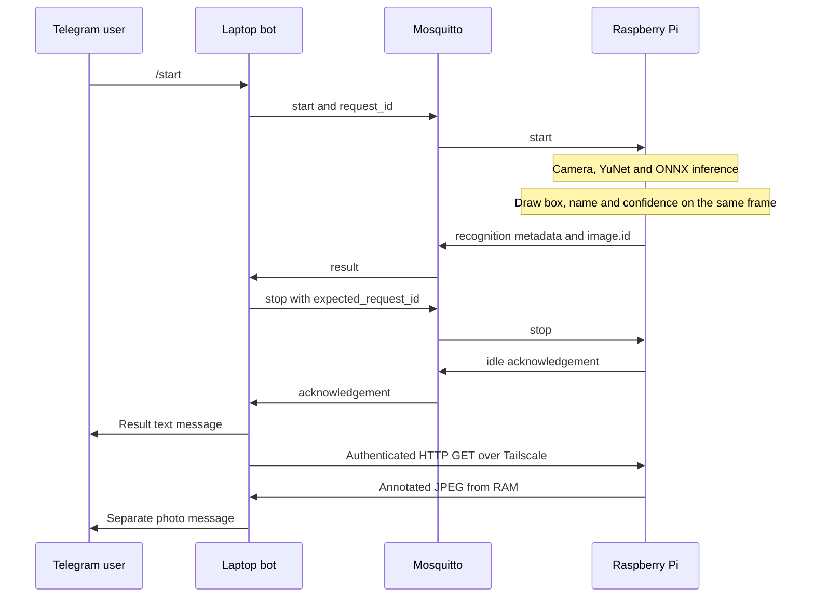

# Ảnh nhận diện qua Telegram

Khi người dùng gửi `/start`, Pi nhận diện cục bộ như trước. Nếu kết quả là thành viên đã đăng ký, bot gửi **hai tin riêng**: tin nhắn kết quả, sau đó ảnh JPEG có bounding box, tên hiển thị và confidence. Unknown không gửi ảnh hoặc tin nhắn.



## Tách MQTT và ảnh

MQTT chỉ truyền JSON. Ví dụ trường thêm trong recognition event:

```json
{
  "image": {
    "id": "7f491c2daf3e4d6faabf590b635b49f3",
    "content_type": "image/jpeg",
    "width": 640,
    "height": 480,
    "bbox": [100, 70, 180, 220],
    "expires_in_s": 120
  }
}
```

Đây là ví dụ schema, không phải kết quả đo. Không đưa bytes/base64 ảnh, token hay URL tùy ý vào MQTT. Bot tải từ origin đã cấu hình trong `.env`, theo `/snapshots/<image-id>.jpg`; chỉ nhận JPEG có giới hạn kích thước, không theo HTTP redirect hoặc proxy môi trường.

HTTP chạy bên trong đường truyền Tailscale được mã hóa. Endpoint chỉ bind địa chỉ Tailscale Pi, có bearer token riêng, không mở port public/router. Token không phải Telegram token và không xuất hiện trên MQTT. Thiếu/sai token trả 401; ảnh không còn trong cache trả 404.

## Dữ liệu và hành vi khi lỗi

- Ảnh lấy từ **đúng frame đã được classifier nhận diện**, vẽ trên frame gốc; không dùng ảnh camera chụp lại sau kết quả. Bounding box là YuNet detector trên frame, confidence là classifier.
- Giữ màu BGR/RGB đã sửa cho USB MJPEG. PIL/DejaVu Sans hiển thị tên tiếng Việt có dấu. Pi cần font `/usr/share/fonts/truetype/dejavu/DejaVuSans.ttf` hoặc đặt `SNAPSHOT_FONT` phù hợp.
- Chỉ tạo ảnh khi kết quả known qua cooldown và MQTT đang online. Unknown/no-face/multiple-faces không tạo snapshot.
- Ảnh ở RAM Pi, tối đa 8 ảnh, mỗi ảnh tối đa 2 MiB, cạnh dài tối đa 1280 px; tự loại sau TTL kể cả khi idle. Không ghi snapshot ra filesystem hoặc dùng ảnh đó để tự train.
- Camera đóng sau guarded stop ACK; HTTP/cache sống độc lập nên bot vẫn tải được ảnh khi camera đã đóng.
- Bot chỉ gửi kết quả nhận diện và ảnh về **chat đã gửi `/start` của request đó**, không phát ảnh cho mọi người từng dùng bot. Mapping được đăng ký trước khi publish start và giới hạn 128 phiên. Sau khi bot restart giữa phiên, hãy `/stop` rồi `/start` lại để tạo phiên có chat nhận.
- Tin nhắn kết quả được gửi trước. Nếu tạo/tải/gửi ảnh lỗi, recognition và auto-stop vẫn hoạt động; bot gửi thông báo không có ảnh. Không thay đổi nhãn hoặc confidence để che lỗi.
- `inference_ms` vẫn chỉ đo classifier; thời gian tải/upload/vẽ ảnh không nằm trong số latency classifier đó.

Ảnh known được gửi lên Telegram khi tính năng này bật; các thành viên tham gia cần đồng ý. Bản mẫu `.env.example` mặc định tắt; phiên demo hiện đã bật theo yêu cầu người dùng. Dataset huấn luyện vẫn lưu cục bộ.

## Cấu hình và triển khai

Sau khi SSH key, Tailscale và config MQTT Pi sẵn sàng:

```bash
.venv/bin/python -m scripts.configure_snapshots --host pi@<PI_TAILSCALE_IP>
```

Script tự đọc IPv4 Tailscale Pi, tạo/reuse token, cập nhật riêng các khóa snapshot trong `.env` hai máy, giữ các config khác. Secret được chuyển qua SSH stdin, không nằm trong argv/log. `.env` có quyền 600. Chạy bước này sau `scripts.configure_pi` nếu provision lại config Pi.

| Biến | Vai trò |
|---|---|
| `RECOGNITION_PHOTO_ENABLED` | Bật trên cả Pi và bot; `false` để chỉ gửi chữ |
| `SNAPSHOT_TOKEN` | Shared secret riêng; tối thiểu 32 ký tự |
| `SNAPSHOT_BASE_URL` | Origin HTTP trên Tailscale của Pi; bot dùng để tải ảnh |
| `SNAPSHOT_BIND` / `SNAPSHOT_PORT` | IP Tailscale Pi và port 8765; chỉ Pi dùng |
| `SNAPSHOT_TTL_S` | Thời gian giữ ảnh, mặc định 120 giây |
| `SNAPSHOT_TIMEOUT_S` | Timeout HTTP, mặc định 5 giây |
| `SNAPSHOT_FONT` | Đường dẫn font Unicode tại Pi |

Deploy code `edgeface/config.py`, `edgeface/snapshot.py`, `raspberry_pi/agent.py`, `raspberry_pi/snapshots.py` lên Pi rồi restart `edgeface.service`. Bot:

```bash
docker compose --profile bot up -d --build telegram
```

Endpoint được mở khi MQTT kết nối; nếu lỗi bind, agent vẫn nhận diện/gửi chữ và thử lại khi có kết quả known. Không cần gửi Telegram credential sang Pi. Không thay model/checkpoint cho tính năng này.

## Kiểm tra

Automated tests kiểm tra annotation không sửa input inference, chữ tiếng Việt, màu, bbox cắt đúng ranh giới, HTTP thật có authentication/expiry, giới hạn RAM, ID không nhận path/URL, Unknown im lặng, hai tin riêng đúng chat, lỗi download/upload vẫn có text và auto-stop.

Kiểm tra triển khai: `RECOGNITION_PHOTO_ENABLED=true` trong container, HTTP từ container tới Pi qua Tailscale trả 401 khi thiếu token và 404 với token đúng nhưng mã ảnh không tồn tại. Kiểm tra live bằng `/start`, đứng một mình trước camera, quan sát đủ tin chữ/ảnh và `/status` về idle. Logs thành công có `Telegram result text sent` và `Telegram recognition photo sent`, cùng request ID; không log token hay bytes ảnh.

Đã chạy **57 tests passed** và kiểm tra live ngày 20/10/2026: request `eb20eb7d-827c-4148-b858-520b78173315`, Pi ACK auto-stop idle lúc 16:22:42 UTC; bot gửi text lúc 16:22:42 và photo lúc 16:22:44. Người dùng xác nhận đã nhận đủ tin nhắn và ảnh có annotation. Broker, bot và MQTT Explorer đều healthy sau triển khai. Đây là kiểm tra chức năng gửi ảnh, không phải thí nghiệm accuracy mới hoặc benchmark hệ thống.
