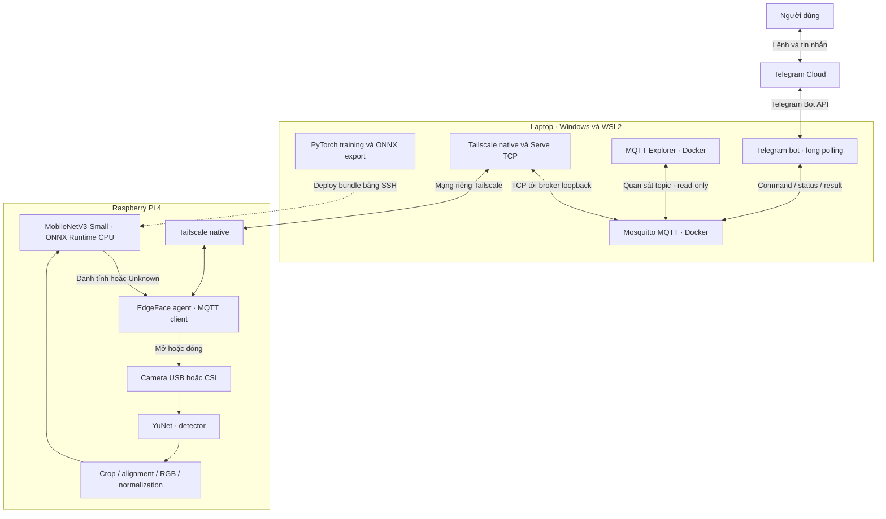
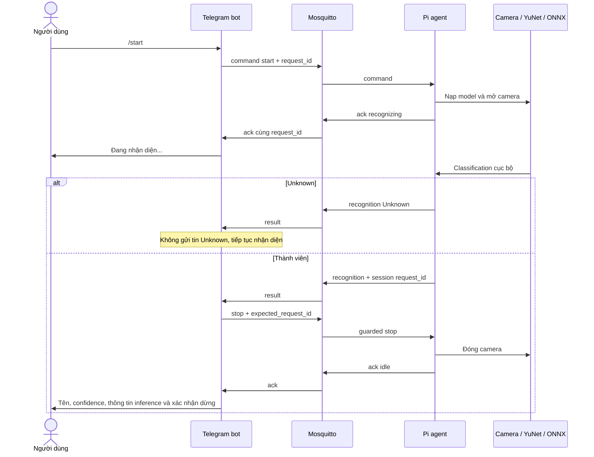
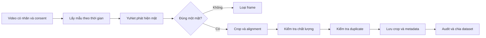
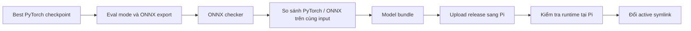
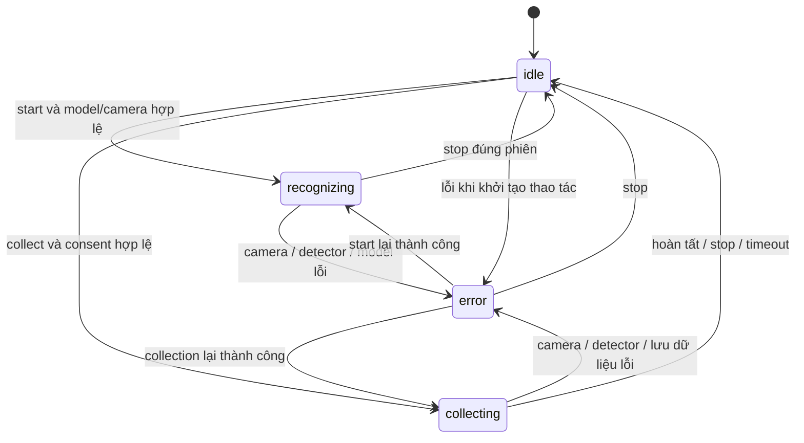

# EdgeFace — Báo cáo kiến trúc hệ thống và phương pháp

**Đề tài:** Hệ thống nhận diện thành viên bằng Deep Learning trên Raspberry Pi, điều khiển qua Telegram và giao tiếp MQTT.

**Phạm vi tài liệu:** kiến trúc, mô hình, xử lý dữ liệu, fine-tuning, chuyển đổi ONNX, triển khai và các kỹ thuật đã xây dựng. Tài liệu là nguồn để team biên soạn báo cáo chính thức và bài thuyết trình về sau.

**Ngày cập nhật:** 11/10/2026.

**Chưa trình bày kết quả thực nghiệm:** chưa đưa accuracy, loss đo được, latency, FPS, mức sử dụng tài nguyên hoặc đối sánh benchmark của bản thử nghiệm một thành viên vào tài liệu này. Sau khi đủ dữ liệu của cả team, cần train lại và thực hiện đánh giá/benchmark cho phiên bản cuối.

## Mục lục

1. [Bài toán và phạm vi](#1-bài-toán-và-phạm-vi)
2. [Kiến trúc tổng thể](#2-kiến-trúc-tổng-thể)
3. [Các thành phần và cấu trúc mã nguồn](#3-các-thành-phần-và-cấu-trúc-mã-nguồn)
4. [Giao thức MQTT và điều khiển](#4-giao-thức-mqtt-và-điều-khiển)
5. [Telegram bot và luồng phản hồi](#5-telegram-bot-và-luồng-phản-hồi)
6. [Camera và mô hình phát hiện khuôn mặt](#6-camera-và-mô-hình-phát-hiện-khuôn-mặt)
7. [Pipeline dữ liệu và chống leakage](#7-pipeline-dữ-liệu-và-chống-leakage)
8. [Mô hình MobileNetV3-Small](#8-mô-hình-mobilenetv3-small)
9. [Phương pháp fine-tuning](#9-phương-pháp-fine-tuning)
10. [Tiền xử lý thống nhất](#10-tiền-xử-lý-thống-nhất)
11. [Unknown và lựa chọn ngưỡng](#11-unknown-và-lựa-chọn-ngưỡng)
12. [Export ONNX và triển khai tại edge](#12-export-onnx-và-triển-khai-tại-edge)
13. [Mạng Tailscale và tự khởi động](#13-mạng-tailscale-và-tự-khởi-động)
14. [Độ tin cậy, lưu trữ và quyền truy cập](#14-độ-tin-cậy-lưu-trữ-và-quyền-truy-cập)
15. [Kiểm thử và đánh giá sau khi đủ dữ liệu](#15-kiểm-thử-và-đánh-giá-sau-khi-đủ-dữ-liệu)
16. [Đối chiếu rubric theo thiết kế hiện tại](#16-đối-chiếu-rubric-theo-thiết-kế-hiện-tại)
17. [Các điểm kỹ thuật để team giải thích](#17-các-điểm-kỹ-thuật-để-team-giải-thích)
18. [Tài nguyên và tài liệu tham khảo](#18-tài-nguyên-và-tài-liệu-tham-khảo)

## 1. Bài toán và phạm vi

### 1.1. Bài toán nhận diện thành viên

EdgeFace nhận ảnh từ camera gắn với Raspberry Pi, phát hiện khuôn mặt, cắt vùng mặt và phân loại người xuất hiện. Nếu có `N` thành viên đăng ký, classifier có `N + 1` lớp: `N` lớp thành viên và một lớp `Unknown`.

Phương pháp nhận diện chính là **classification bằng mạng neural đã fine-tune**. Hệ thống không lấy embedding rồi tìm khuôn mặt gần nhất bằng cosine similarity. Việc chọn classification giúp thể hiện rõ quá trình thay classification head, cập nhật trọng số bằng dữ liệu của nhóm và triển khai mô hình đã học lên thiết bị biên.

Face detection và face classification là hai bài toán riêng. Detector xác định vị trí khuôn mặt; classifier nhận crop mặt và dự đoán danh tính. Một frame không có mặt sẽ không được đưa vào classifier. Frame có nhiều mặt cũng không được tự gán nhãn cho một người trong chế độ hiện tại.

### 1.2. Mục tiêu hệ thống

Hệ thống kết hợp ba phần: camera và xử lý ảnh tại Pi; pipeline training/export trên laptop; ứng dụng điều khiển, giám sát bằng Telegram và MQTT Explorer. Laptop có thể dùng GPU để training, nhưng **toàn bộ inference khi vận hành nằm trên Pi**.

Telegram Cloud chỉ phục vụ gửi/nhận lệnh và tin nhắn. MQTT chỉ truyền JSON chứa command, trạng thái, sự kiện và telemetry. Video, frame camera và crop mặt không được gửi qua MQTT hoặc lên Telegram theo cấu hình mặc định.

Phiên bản hiện tại ưu tiên nhận diện qua Telegram; thu thập bằng camera qua bot đã có module nhưng chưa là nguồn dataset của cả team. Âm thanh đang tắt. Không có liveness detection và không xem hệ thống là giải pháp kiểm soát truy cập chống giả mạo đã được kiểm chứng.

## 2. Kiến trúc tổng thể

### 2.1. Kiến trúc đang sử dụng



Đường nét đứt biểu diễn deployment, không phải đường gửi ảnh để suy luận từ xa. Khi demo, classifier nhận dữ liệu từ camera Pi, không gọi mô hình trên laptop.

### 2.2. Phân công tài nguyên

| Thành phần | Vai trò |
|---|---|
| Laptop/WSL | Chuẩn bị dataset, fine-tune, calibration threshold, export và kiểm tra ONNX |
| GPU laptop, nếu khả dụng | Tăng tốc training PyTorch; không tham gia inference của Pi |
| Docker Compose laptop | Chạy broker Mosquitto, Telegram bot và MQTT Explorer |
| Raspberry Pi | Capture camera, detect/crop, preprocess, classify ONNX và gửi metadata |
| Telegram | Giao diện gửi lệnh, nhận kết quả nhận diện và truy vấn trạng thái |
| MQTT Explorer | Quan sát topic, payload và telemetry trong lúc hệ thống hoạt động |
| Tailscale | Cung cấp đường kết nối riêng giữa WSL và Pi |

Pi hiện được triển khai native trên Debian ARM64 với Python, OpenCV, Picamera2 và ONNX Runtime CPU. Cách này tận dụng driver camera có sẵn trên Pi. Container chỉ dùng cho các backend laptop, không đặt camera runtime Pi trong Docker.

### 2.3. Tách biệt training và inference

Training dùng dữ liệu có nhãn đã thu trước, optimizer và backpropagation. Inference chỉ nạp model cùng cấu hình, thực hiện forward pass và áp dụng quy tắc Unknown. Pi không cần PyTorch trong đường chạy inference; PyTorch là dependency của pipeline training và công cụ đối sánh tùy chọn.

Tách hai môi trường giúp tránh việc mang toàn bộ CUDA/training stack lên thiết bị biên. Khi cập nhật mô hình, hệ thống chuyển một model bundle thay vì sửa logic nhận diện trên Pi.

## 3. Các thành phần và cấu trúc mã nguồn

| Module/tài nguyên | Trách nhiệm |
|---|---|
| [`edgeface/config.py`](../edgeface/config.py) | Cấu hình tập trung qua environment variables và `.env` |
| [`edgeface/protocol.py`](../edgeface/protocol.py) | Command schema, UUID, thời gian, TTL, kiểm tra tên và cooldown |
| [`edgeface/mqtt.py`](../edgeface/mqtt.py) | MQTT client, reconnect, QoS, subscription và LWT |
| [`edgeface/preprocess.py`](../edgeface/preprocess.py) | Tiền xử lý chung, softmax, rejection và bundle version |
| [`edgeface/names.py`](../edgeface/names.py) | Mapping class ID sang tên hiển thị |
| [`telegram_bot/bot.py`](../telegram_bot/bot.py) | Long polling, command dispatch, nhận event và auto-stop |
| [`raspberry_pi/agent.py`](../raspberry_pi/agent.py) | State machine và vòng xử lý thiết bị |
| [`raspberry_pi/camera.py`](../raspberry_pi/camera.py) | Capture USB/CSI, đóng/mở và lỗi camera |
| [`raspberry_pi/detection.py`](../raspberry_pi/detection.py) | YuNet, landmarks và crop/rotation |
| [`raspberry_pi/collection.py`](../raspberry_pi/collection.py) | Lọc chất lượng, chống trùng, lưu crop và metadata |
| [`raspberry_pi/inference.py`](../raspberry_pi/inference.py) | ONNX Runtime CPU, kiểm tra bundle và prediction |
| [`training/import_video.py`](../training/import_video.py) | Tách frame từ video sau khi detect/crop mặt |
| [`training/fetch_unknown.py`](../training/fetch_unknown.py) | Chuẩn bị subset Unknown từ LFW có provenance |
| [`training/dataset.py`](../training/dataset.py) | Audit, chống duplicate/leakage và tạo split |
| [`training/model.py`](../training/model.py) | Tạo MobileNetV3-Small và load checkpoint |
| [`training/train.py`](../training/train.py) | Head training, fine-tuning và checkpoint |
| [`training/evaluate.py`](../training/evaluate.py) | Chọn threshold bằng validation và đánh giá test |
| [`training/export_onnx.py`](../training/export_onnx.py) | Export, checker và kiểm tra PyTorch/ONNX parity |
| [`scripts/deploy_model.py`](../scripts/deploy_model.py) | Deploy release, kiểm tra trên Pi và đổi active symlink |
| [`docker-compose.yml`](../docker-compose.yml) | Backend laptop và volume/config liên quan |

Các module chính có type hints và logging. Dataset, checkpoint training và environment chứa secret được loại khỏi Git. Riêng bundle ONNX hiện tại và detector YuNet được chia sẻ bằng Git LFS để team chạy demo; các model cache và release cũ giữ cục bộ. `classes.json` và preprocessing đi cùng model để không phụ thuộc danh sách thành viên hardcode trong code.

## 4. Giao thức MQTT và điều khiển

### 4.1. Vì sao dùng MQTT

MQTT dùng mô hình publish/subscribe: bên gửi không cần kết nối trực tiếp với mọi bên nhận. Pi và Telegram bot giao tiếp qua broker; MQTT Explorer có thể quan sát cùng topic mà không chen vào logic điều khiển. Cách tổ chức này phù hợp với hệ thống thiết bị gửi trạng thái, nhận command và phát sự kiện. Ngữ nghĩa QoS, retained message và Last Will được định nghĩa trong [MQTT 3.1.1 của OASIS](https://docs.oasis-open.org/mqtt/mqtt/v3.1.1/os/mqtt-v3.1.1-os.html).

Broker dùng Eclipse Mosquitto. Client Python dùng Paho MQTT. Luồng MQTT không chứa ảnh nên kích thước thông điệp nhỏ và cấu trúc payload có thể kiểm tra bằng JSON.

### 4.2. Topic và loại thông điệp

Prefix cấu hình mặc định là `aiot/edgeface`.

| Topic | Bên gửi | Nội dung | QoS / retained |
|---|---|---|---|
| `aiot/edgeface/command` | Bot hoặc công cụ điều khiển | `start`, `stop`, `status`, `members`, collection | QoS 1; không retained |
| `aiot/edgeface/status` | Pi | Trạng thái, phản hồi command và online/offline | QoS 1; snapshot/LWT retained, ack không retained |
| `aiot/edgeface/result` | Pi | Recognition, no-face hoặc multiple-faces | QoS 1; không retained |
| `aiot/edgeface/telemetry` | Pi | CPU, RAM, nhiệt độ, model và thông tin vận hành | QoS 0; không retained |
| `aiot/edgeface/collection` | Pi | Tiến độ/kết thúc thu thập crop | QoS 1; không retained |

QoS 1 có thể giao một thông điệp nhiều lần; vì vậy ứng dụng phải tự chống thực thi lại. QoS 2 bảo đảm exactly-once delivery trong trao đổi MQTT khi trạng thái giao thức được duy trì, nhưng một lần publish mới có cùng nội dung vẫn là thông điệp mới; QoS 2 không thay thế request ID, TTL hoặc lưu trạng thái chống lặp ở tầng ứng dụng. QoS 0 cho telemetry chấp nhận mất một sample để không tạo backlog. Một snapshot retained chỉ là trạng thái gần nhất, không phải cơ sở dữ liệu lịch sử.

### 4.3. Correlation và kiểm tra command

Command có `request_id` dạng UUID, `device_id`, `action` và `timestamp` ISO8601 có timezone. Bot giữ một pending request theo UUID. Pi trả ack mang cùng ID để bot biết phản hồi thuộc lệnh nào.

Các kiểm tra gồm action được phép, đúng thiết bị, UUID hợp lệ, timestamp không quá hạn và payload không vượt giới hạn. TTL command và timeout chờ ack là hai cấu hình khác nhau: TTL quyết định Pi còn được thực thi lệnh hay không; timeout quyết định bot chờ phản hồi trong bao lâu.

Command `stop` tự động có thêm `expected_request_id`, tham chiếu phiên nhận diện đã phát ra kết quả. Pi chỉ dừng khi phiên hiện tại khớp ID này. Nhờ vậy, kết quả đến chậm của phiên cũ không làm dừng phiên mới.

### 4.4. Chống replay và reconnect

Pi dùng SQLite để claim request ID trước khi mở camera hoặc tạo hiệu ứng. Request đã xử lý được trả lại phản hồi đã lưu thay vì thực hiện lần nữa. Đây là cơ chế chống lặp ở tầng ứng dụng, không phải lời khẳng định MQTT QoS 1 tự bảo đảm exactly-once.

Nếu tiến trình chết sau khi claim nhưng trước khi hoàn tất thao tác, request có thể tồn tại mà chưa có phản hồi hoàn chỉnh. Hệ thống không tự phát lại hiệu ứng trong trường hợp này; người điều khiển cần truy vấn trạng thái. Cách xử lý ưu tiên tránh lặp thao tác ngoài ý muốn.

MQTT client có reconnect với backoff và clean session. Retained command bị từ chối. Khi offline, event mới không được giữ để gửi lại như kết quả nhận diện hiện thời sau reconnect. LWT của Pi báo offline nếu broker phát hiện mất client bất thường.

## 5. Telegram bot và luồng phản hồi

### 5.1. Long polling

Bot dùng `python-telegram-bot` với long polling, không cần webhook, domain hoặc public IP. Token được đọc từ environment; không đưa token vào source. Long polling chạy ở laptop, còn Pi chỉ biết MQTT credential thiết bị.

Bot xử lý MQTT qua cầu nối từ callback thread sang asyncio event loop. Ack được giải quyết trực tiếp trên loop, để tác vụ đang chờ auto-stop vẫn nhận được phản hồi; không bắt ack phải đi qua chính consumer đang chờ tác vụ đó.

### 5.2. Các command

| Command | Hành vi |
|---|---|
| `/start` | Gửi lệnh nhận diện; khi Pi xác nhận thì phản hồi “Đang nhận diện...” |
| `/stop` | Gửi lệnh dừng; Pi đóng camera và về idle |
| `/status` | Truy vấn trạng thái thực tế, model và telemetry liên quan |
| `/members` | Liệt kê class thành viên trong model và dữ liệu đã có |
| `/help` | Hướng dẫn dùng bot |
| `/collect <name>` | Module thu crop camera sau xác nhận consent |
| `/collect_unknown <anonymous-id>` | Module thu Unknown với danh tính ẩn danh phục vụ split |

Collection đã có code nhưng còn cần kiểm chứng với dữ liệu thực tế của cả team. Phiên bản sử dụng hiện tại tập trung vào video thành viên cung cấp và nhận diện camera, không yêu cầu bật collection hoặc âm thanh.

### 5.3. Luồng nhận diện và auto-stop



Unknown vẫn có trên MQTT để quan sát; chỉ bị ẩn ở giao diện Telegram. No-face và multiple-faces là các sự kiện khác, không kích hoạt auto-stop như thành viên. Bot không thông báo đã dừng thành công nếu chưa có ack phù hợp.

### 5.4. Cooldown và tên hiển thị

Cooldown áp dụng theo nhãn trong mỗi phiên để giảm thông báo lặp. Khi người dùng chủ động mở một phiên mới bằng `/start`, cooldown được reset để phiên mới phản hồi ngay. Auto-stop sau thành viên cũng giúp tránh gửi nhiều kết quả của một người đứng lâu trước camera.

Class ID và tên hiển thị tách biệt. Ví dụ `son` được mapping thành `Nguyễn Hồ Trường Sơn` trong [`configs/display_names.json`](../configs/display_names.json). Thay đổi tên hiển thị không cần train lại; thêm class thành viên mới thì phải thay đổi classifier và train lại.

## 6. Camera và mô hình phát hiện khuôn mặt

### 6.1. Capture trên Raspberry Pi

`Camera` hỗ trợ Picamera2/libcamera và USB V4L2 qua OpenCV. Chế độ `auto` thử libcamera trước rồi fallback V4L2. Không suy ra USB luôn phải dùng V4L2: camera USB hiện tại cũng được libcamera quản lý.

Kích thước capture, index camera và backend đều cấu hình được. Buffer được giới hạn trong cấu hình capture; không lưu một hàng đợi frame tăng không giới hạn. Camera chỉ mở khi có lệnh cần camera, được đóng khi stop, lỗi hoặc shutdown.

Camera trả frame BGR cho pipeline OpenCV. Picamera2 `RGB888` có byte ordering tương ứng BGR trong cách capture đang dùng, nên việc chuyển sang RGB được thực hiện ở bước preprocess chung. Tên format và thứ tự byte phải được phân biệt để tránh đổi sai kênh màu.

### 6.2. Detector YuNet

YuNet là face detector pretrained nhẹ, sử dụng qua `cv2.FaceDetectorYN`. Detector trả bounding box, landmarks và detection score. Hệ thống dùng bản model `face_detection_yunet_2023mar.onnx` tương thích môi trường OpenCV hiện tại, không tự chuyển sang bản model mới chỉ vì upstream có phiên bản khác. Tham khảo [OpenCV Zoo YuNet](https://github.com/opencv/opencv_zoo/tree/main/models/face_detection_yunet).

Detector không được fine-tune trong pipeline hiện tại. Fine-tuning thuộc classifier MobileNetV3-Small. Hai model có input/output và chức năng khác nhau nên không được mô tả YuNet là mô hình dự đoán tên thành viên.

### 6.3. Crop và alignment

Nếu có đúng một mặt, hệ thống lấy bounding box và landmarks hai mắt. Khi vị trí mắt hợp lệ và góc nghiêng nằm trong phạm vi xử lý, ảnh được xoay quanh vùng mắt; bounding box được biến đổi theo cùng phép xoay. Crop có padding nhỏ và được chặn trong biên ảnh.

Đây là alignment đơn giản theo mắt, không phải tái dựng khuôn mặt 3D hoặc frontalization. Crop vẫn có thể chứa tóc, kính và một phần vùng xung quanh mặt; mục tiêu là giảm ảnh hưởng của background toàn frame, không khẳng định đã loại bỏ mọi thông tin môi trường.

Khi import video lớn, detector chạy trên ảnh thu nhỏ, sau đó tọa độ được quy đổi về frame gốc để crop. Cách này giảm công việc detection trong khâu chuẩn bị dữ liệu, đồng thời giữ chất lượng crop từ nguồn gốc.

## 7. Pipeline dữ liệu và chống leakage

### 7.1. Nguồn dữ liệu

Dữ liệu thành viên có thể đến từ video do chính thành viên cung cấp hoặc module camera collection trên Pi. Đối với video, tên class được xác định ở lúc import; chỉ nhận dữ liệu người đã đồng ý tham gia. Mỗi video cần thuộc một người, tránh gán nhãn tùy tiện khi nhiều người xuất hiện trong frame.

Lớp Unknown sử dụng subset ảnh LFW công khai. Importer lưu nguồn archive, checksum và nhóm theo danh tính; chỉ decode ảnh được chọn, không giải nén tùy ý đường dẫn trong archive. LFW là nguồn ảnh khuôn mặt cho nghiên cứu, nhưng dự án này chỉ dùng một subset cho lớp Unknown, không thực hiện giao thức face verification chuẩn của LFW. Nguồn khoa học: [LFW technical report](https://people.cs.umass.edu/~elm/papers/lfw.pdf).

Dữ liệu công khai không có nghĩa nhóm đã xác minh được consent riêng của mọi người trong ảnh. Phần provenance phải giữ thông tin nguồn; không mô tả Unknown web là ảnh được nhóm trực tiếp thu thập hoặc phân phối lại toàn bộ ảnh trong tài liệu công khai.

### 7.2. Các bước xử lý video



Importer không lưu mọi frame liên tiếp. Tham số sampling interval giới hạn tần suất lấy mẫu, giảm ảnh rất giống nhau và giảm phụ thuộc vào frame rate nguồn. Sau sampling, frame vẫn phải qua detector và bộ lọc chất lượng.

### 7.3. Bộ lọc chất lượng

| Kiểm tra | Mục đích | Cách xử lý đang dùng |
|---|---|---|
| Số khuôn mặt | Bảo đảm nhãn thuộc một người | Chỉ chấp nhận đúng một face |
| Kích thước mặt | Loại crop thiếu thông tin chi tiết | Kiểm tra kích thước bounding box |
| Độ mờ | Loại frame rung hoặc mất nét | Variance của Laplacian trên ảnh tham chiếu |
| Độ sáng | Loại crop quá tối hoặc quá sáng | Mean grayscale so với khoảng cấu hình |
| Near-duplicate | Giảm mẫu gần giống nhau | dHash và Hamming distance |
| Decode/checksum | Bảo đảm dữ liệu còn nguyên | PIL/OpenCV và SHA256 trong audit |

Blur được đo trên ảnh tham chiếu `224 × 224` để giảm phụ thuộc độ phân giải nguồn. Nếu đo trực tiếp trên một crop lớn hơn nhiều, giá trị Laplacian variance có thể khác dù ảnh nhìn vẫn rõ. Các ngưỡng chất lượng là tham số xử lý dữ liệu, cần kiểm tra với video thực tế, không được gọi là ngưỡng tối ưu phổ quát.

dHash biểu diễn quan hệ sáng/tối giữa pixel lân cận sau khi thu nhỏ ảnh. Hamming distance nhỏ gợi ý hai crop gần giống nhau. Đây là heuristic chống trùng ảnh, không phải embedding nhận diện người và không chứng minh hai video độc lập về điều kiện quay.

### 7.4. Lưu trữ và provenance

```text
dataset/
  videos/<class_id>/<recording>.mp4
  raw/<class_id>/<session_id>/
    <crop>.jpg
    session.json
  processed/
    train/<class_id>/
    val/<class_id>/
    test/<class_id>/
    manifest.json
  metadata/
  revisions/<revision_name>/
```

Metadata liên kết crop với class, session, video nguồn, SHA256, thời điểm trong video, chất lượng và consent. `source_recording` giúp nhận ra cùng video dù file đã đổi tên hoặc được import lại. `session_id` mới không tự biến các frame từ cùng nguồn thành một phiên độc lập.

Manifest lưu class order, split của mỗi sample, provenance và protocol đánh giá. Checkpoint lưu hash manifest đã dùng để train; bước evaluation/export kiểm tra hash này để tránh ghép nhầm checkpoint với dataset khác.

Dataset revision và checkpoint được giữ riêng thay vì ghi đè tùy ý. Cách tổ chức này hỗ trợ tái lập và rollback. Tuy nhiên, giữ revision tạo thêm bản sao sinh trắc học; khi xóa dữ liệu phải tính cả revision, crop benchmark, ảnh diagnostic và các bản đồng bộ.

### 7.5. Tách train/validation/test

Phương án ưu tiên là chia theo **nguồn quay độc lập** cho từng thành viên, không random từng frame của cùng video sang ba tập. Với Unknown, đơn vị chia là danh tính: người thuộc test không xuất hiện trong train/validation.

Nếu chỉ có ít video, pipeline có fallback chia đoạn trong từng video: train ở phần đầu, validation và test ở các đoạn sau, có khoảng bỏ trống giữa các tập. Khoảng trống giảm frame sát nhau đi qua ranh giới; bước near-duplicate tiếp tục loại crop gần giống qua split.

Fallback temporal cần opt-in rõ qua `--allow-single-video-temporal` hoặc `--allow-multi-video-temporal`. Manifest không được đánh dấu `independent_known_test=true` khi nguồn quay known còn giao nhau giữa test và train/validation.

Khi có đủ dữ liệu team, nên tạo dataset mới bằng split theo phiên. Dữ liệu temporal cũ không được ghép với session split rồi tự tuyên bố test độc lập. Nếu warm-start từ checkpoint trước, cũng phải kiểm tra ảnh mà checkpoint đã train không bị chuyển sang tập đánh giá mới.

## 8. Mô hình MobileNetV3-Small

### 8.1. Lựa chọn mô hình

MobileNetV3-Small là backbone CNN hướng đến thiết bị hạn chế tài nguyên. Dự án dùng weights `MobileNet_V3_Small_Weights.IMAGENET1K_V1` từ torchvision, rồi thay lớp output cho bài toán thành viên. Cơ sở lựa chọn là khả năng transfer learning và kiến trúc phù hợp xử lý tại edge; hiệu năng của phiên bản đầy đủ vẫn cần đo trên Pi sau khi train dữ liệu team. Tham khảo [Searching for MobileNetV3](https://arxiv.org/abs/1905.02244) và [torchvision MobileNetV3-Small](https://docs.pytorch.org/vision/stable/models/generated/torchvision.models.mobilenet_v3_small.html).

Pretrained ImageNet cung cấp trọng số ban đầu để trích xuất đặc trưng ảnh. Các class ImageNet không phải tên thành viên; vì vậy không thể dùng nguyên output ImageNet rồi gọi đó là model nhận diện của nhóm.

### 8.2. Classification head

Input classifier là tensor `1 × 3 × 224 × 224` khi deploy. Feature extractor và pooling chuyển ảnh thành đặc trưng; classifier cuối cùng trả `K = N + 1` logits.

```text
RGB face crop
  → MobileNetV3-Small features
  → pooling / classifier hidden representation
  → Linear(1024, K)
  → K logits
```

`Linear(1024, K)` được khởi tạo cho số class của dataset. Phần còn lại lấy từ pretrained weights khi train mới. Danh sách `classes.json` cố định thứ tự output; không được đổi thứ tự file này sau export mà không cập nhật trọng số tương ứng.

Ví dụ tên thành viên trên Telegram có thể thay qua mapping, nhưng số class và class ID thuộc mô hình. Khi đủ dữ liệu cả team, classifier phải được tạo với đúng `N + 1` output.

### 8.3. Quan hệ giữa các model

| Model | Vai trò | Có fine-tune trong pipeline? |
|---|---|---|
| YuNet pretrained | Phát hiện khuôn mặt và landmarks | Không |
| MobileNetV3-Small ImageNet | Khởi tạo backbone cho classification | Có, thông qua head và block cuối |
| Checkpoint PyTorch sau training | Lưu trọng số và provenance để train/evaluate/export | Là kết quả training |
| Classifier ONNX | Biểu diễn deploy của classifier đã học | Không train trực tiếp trên Pi |

ONNX không phải một model khác được huấn luyện từ đầu. Nó là biểu diễn xuất từ checkpoint, cần kiểm tra giữ đúng hành vi PyTorch trước khi sử dụng.

## 9. Phương pháp fine-tuning

### 9.1. Training hai giai đoạn

Giai đoạn đầu đóng băng backbone và train các lớp classifier. Cách này giúp head thích nghi với nhãn mới trước khi thay đổi feature extractor. Giai đoạn sau mở một số block cuối của backbone cùng classifier, dùng learning rate nhỏ hơn để thích nghi đặc trưng mà hạn chế làm thay đổi mạnh toàn bộ pretrained model.

Trong code hiện tại, nhóm tham số backbone được mở ở giai đoạn fine là `features.10`, `features.11` và `features.12`. Phần `classifier` được train trong cả hai giai đoạn. Do dataset khuôn mặt còn nhỏ, BatchNorm statistics được giữ cố định trong lúc training.

| Kỹ thuật | Cách dùng |
|---|---|
| Transfer learning | Khởi tạo MobileNetV3-Small bằng ImageNet weights |
| Freeze/unfreeze | Head trước, block cuối sau |
| Optimizer | AdamW, có weight decay |
| Learning rate | Giai đoạn fine thấp hơn giai đoạn head; có CLI để cấu hình |
| Early stopping | Dừng khi validation loss không cải thiện sau patience |
| Best checkpoint | Chọn theo validation loss, không theo test |
| Random seed | Seed Python, NumPy, PyTorch; cấu hình cuDNN phục vụ tái lập |
| CPU/GPU training | Chọn CUDA khi khả dụng; có đường chạy CPU |

Các giá trị learning rate/epoch trong CLI là cấu hình khởi đầu, không phải kết luận tối ưu cho dữ liệu cả team. Seed hỗ trợ tái lập trong môi trường tương đương; không bảo đảm bitwise identity giữa mọi phiên bản thư viện hoặc thiết bị.

### 9.2. Augmentation

Augmentation training gồm horizontal flip, affine nhẹ và color jitter mức vừa phải. Các biến đổi này nhằm mô phỏng thay đổi hướng mặt, vị trí, scale và điều kiện sáng, nhưng không thay thế việc quay nhiều phiên thực tế.

Validation/test không áp dụng augmentation ngẫu nhiên. Hai tập này dùng pipeline deterministic để phép đo không phụ thuộc một lần bốc thăm biến đổi ảnh. Không tạo dữ liệu mặt giả để rồi xem là ảnh thật của thành viên.

### 9.3. Class imbalance và loss

Training dùng cross-entropy với class weights. Nếu train có tổng `M` ảnh, `K` class và class `c` có `n_c` ảnh, code đặt:

```text
w_c = M / (K × n_c)
```

Class ít ảnh được weight lớn hơn. Với logits `z`, softmax cho xác suất tương đối `p`; weighted cross-entropy cho một batch được tính từ `-w_y × log(p_y)`, với chuẩn hóa theo class weights trong loss của PyTorch. Loss epoch được tổng hợp theo số sample của các batch.

Class weights giúp giảm thiên lệch do số lượng crop, nhưng không giải quyết hoàn toàn tương quan giữa frame hoặc khác biệt domain giữa video thành viên và Unknown web.

### 9.4. Train tiếp checkpoint

`--init-checkpoint` cho phép bắt đầu từ model đã train và dùng thêm dữ liệu mới. Head và block cuối tiếp tục được cập nhật; training replay dữ liệu cũ giúp hạn chế quên kiến thức đã học.

Warm-start hiện yêu cầu class order và preprocessing của checkpoint trùng dataset mới. Do đó, model một thành viên không thể dùng trực tiếp cùng head khi số thành viên tăng. Với dataset đầy đủ của team, phải tạo head tương ứng; có thể train mới từ ImageNet bằng pipeline hiện có.

Checkpoint chứa weights, classes, preprocessing, seed, epoch/stage, validation loss và manifest hash. Khi train tiếp, provenance ghi thêm hash checkpoint cha. Nhờ đó nhóm có thể giải thích model đang deploy được tạo từ dữ liệu và giai đoạn nào.

## 10. Tiền xử lý thống nhất

Tiền xử lý được định nghĩa một lần trong `edgeface/preprocess.py` và sử dụng bởi dataset training lẫn inference Pi:

```text
BGR crop từ OpenCV
  → RGB
  → resize trực tiếp 224 × 224 bằng PIL bilinear
  → float32 và chia 255
  → normalize theo mean/std
  → transpose HWC thành CHW
  → thêm batch dimension: NCHW
```

```text
mean = [0.485, 0.456, 0.406]
std  = [0.229, 0.224, 0.225]
x_normalized[c] = (x[c] / 255 - mean[c]) / std[c]
```

Các mean/std thuộc chuẩn normalization ImageNet, nhưng dự án resize crop mặt trực tiếp về input, không mô tả pipeline là nguyên xi toàn bộ transform mặc định của ImageNet. Lựa chọn này phải nhất quán ở training, validation, export và Pi.

`preprocessing.json` được đi cùng model. Runtime kiểm tra cấu hình có khớp implementation được hỗ trợ hay không; mismatch được báo lỗi model thay vì âm thầm suy luận với tiền xử lý khác.

## 11. Unknown và lựa chọn ngưỡng

### 11.1. Hai lớp bảo vệ ở mức classification

Hệ thống train một class Unknown riêng, đồng thời áp dụng confidence threshold:

```python
predicted = classes[argmax(probabilities)]
confidence = max(probabilities)
if predicted == "Unknown" or confidence < threshold:
    result = "Unknown"
else:
    result = predicted
```

Softmax được tính theo dạng ổn định số học bằng cách trừ max logit trước khi exponentiate. Output NaN/Inf hoặc sai số chiều là lỗi model, không được biến thành một dự đoán Unknown bình thường.

Unknown do threshold có thể bắt đầu từ một known class có confidence thấp. Vì vậy, confidence của event vẫn là max softmax trước rejection, không nhất thiết là xác suất output của class Unknown.

### 11.2. Chọn threshold bằng validation

Không đặt mặc định một con số rồi gọi là threshold tối ưu. Script calibration thử các ứng viên từ phân bố confidence validation, gồm midpoint và chance floor `1/K`.

Mục tiêu lựa chọn dùng:

```text
Known accuracy = số known đúng danh tính / tổng sample known
Unknown rejection = số sample unknown bị từ chối / tổng sample unknown
Balanced known/unknown score = (Known accuracy + Unknown rejection) / 2
Validation FAR = số unknown được chấp nhận như thành viên / tổng sample unknown
```

Ưu tiên ứng viên thỏa FAR validation mục tiêu, sau đó tối đa balanced score; tie-break theo known accuracy và threshold bảo thủ hơn. Nếu không có ứng viên thỏa ràng buộc, code chọn từ tập ứng viên còn lại; trong trường hợp này không được khẳng định đã đạt FAR mục tiêu.

Threshold được gắn với checkpoint và manifest dùng để calibration. Test không được dùng để chọn threshold hoặc hyperparameter. Khi model/class set thay đổi, phải calibration lại thay vì giữ ngưỡng của model cũ tùy ý.

### 11.3. Giới hạn Unknown

Một class Unknown chỉ đại diện cho những kiểu người lạ trong dữ liệu, không bao phủ mọi khuôn mặt ngoài nhóm. Model có thể vẫn cho confidence cao đối với người lạ giống thành viên hoặc khác hoàn toàn dữ liệu web.

Chọn threshold là lựa chọn quy tắc ra quyết định, không có nghĩa softmax đã được probability calibration. Confidence cao không chứng minh xác suất danh tính đúng ngoài thực tế có cùng giá trị.

Unknown cũng không phải anti-spoofing. Ảnh in hoặc ảnh trên màn hình của thành viên có thể được classify thành đúng tên người đó; chưa có liveness detector để phân biệt người thật và ảnh.

## 12. Export ONNX và triển khai tại edge

### 12.1. Quy trình chuyển đổi



Checkpoint được chuyển sang `eval()` trước export để không dùng dropout training và không cập nhật thống kê BatchNorm. Input deploy cố định là float32 `1 × 3 × 224 × 224`, output là logits `1 × K`.

Exporter hiện chọn opset 17, phù hợp với ONNX Runtime đã dùng trên Pi. ONNX checker kiểm tra tính hợp lệ của graph; kiểm tra IR version giúp tránh graph quá mới so với runtime. Đây là kiểm tra tương thích, chưa phải benchmark hiệu năng.

### 12.2. Kiểm tra tương đương

PyTorch và ONNX Runtime nhận cùng tensor đã preprocess. Script so sánh logits với tolerance, so sánh argmax và quyết định sau threshold. Nếu sai khác làm thay đổi nhãn, export không được xem là đạt chỉ vì file ONNX có thể mở.

Các kiểm tra này nhằm phát hiện lỗi conversion/preprocessing. Chúng không thay thế test accuracy của mô hình: hai runtime có thể cho cùng một dự đoán nhưng dự đoán đó vẫn sai danh tính.

### 12.3. Model bundle

| File | Nội dung |
|---|---|
| `face_classifier.onnx` | Graph và trọng số classifier |
| `classes.json` | Thứ tự class ứng với output |
| `preprocessing.json` | Color, resize, normalization, layout và dtype |
| `threshold.json` | Ngưỡng lấy từ validation và provenance liên quan |
| `export_validation.json` | Thông tin checker, parity, versions và checksum |

Version của model dựa vào SHA256 file ONNX. Bundle version còn tính classes, preprocessing và threshold; đổi ngưỡng mà giữ nguyên weights vẫn tạo bundle khác. Hash giúp kiểm tra đúng artifact, không phải cơ chế xác thực danh tính người trong ảnh.

### 12.4. ONNX Runtime CPU

Pi dùng `CPUExecutionProvider`. Session đặt số intra-op threads qua cấu hình, inter-op threads và execution mode để kiểm soát thực thi. Runtime kiểm tra input shape/dtype, output shape và class count trước khi nhận diện.

Kỹ thuật tối ưu đã chọn gồm backbone nhỏ, crop mặt trước classifier, graph export có constant folding và ONNX Runtime CPU. Runtime có các cơ chế tối ưu thực thi graph; mức lợi ích của phiên bản đầy đủ phải được đo sau khi train dữ liệu team. Tham khảo [ONNX Runtime performance](https://onnxruntime.ai/docs/performance/).

**Chưa triển khai pruning hoặc INT8 quantization.** Định dạng ONNX và việc dùng ONNX Runtime không có nghĩa model đã được lượng tử hóa. Nếu thêm INT8 về sau, cần calibration thích hợp, kiểm tra operator support trên Pi và đánh giá lại chất lượng/threshold.

### 12.5. Release và rollback

Model được upload vào `models/releases/<bundle_version>/`. Script kiểm tra checksum và khả năng tạo classifier trên Pi trước khi chuyển symlink `models/active`. Các release cũ được giữ để rollback; không ghi đè trực tiếp lên file model đang dùng.

Agent nạp classifier khi xử lý `start`. Vì vậy, sau khi đổi release cần dừng phiên cũ rồi mở phiên mới để model trong bộ nhớ khớp bundle active. Chỉ đổi symlink không có nghĩa một session đã mở sẽ tự thay weights trong RAM.

Mô hình phát hiện YuNet và classifier là hai artifact riêng. Đổi classifier không bắt buộc thay detector nếu môi trường và preprocessing vẫn phù hợp.

## 13. Mạng Tailscale và tự khởi động

### 13.1. Vì sao cần lớp kết nối cho WSL

Broker chạy trong Docker của WSL, bind vào loopback. Việc Pi và Windows laptop dùng cùng Wi-Fi không tự làm endpoint loopback WSL truy cập được từ Pi. Phiên bản trước dùng SSH reverse tunnel; đường hiện tại dùng Tailscale native trên cả WSL và Pi.

```text
Pi MQTT client
  → WSL Tailscale address:1883
  → Tailscale Serve TCP
  → 127.0.0.1:1883 trên WSL
  → Mosquitto container
```

Đây là TCP forwarding trong mạng riêng Tailscale, không dùng SSH tunnel cho MQTT. SSH vẫn dùng cho quản trị và deployment. Không dùng Tailscale Funnel để đưa MQTT ra Internet công khai.

Tailscale là lớp truyền dẫn; nó không thay Mosquitto, MQTT schema hoặc MQTT authentication. MQTT Explorer và bot trong Docker vẫn dùng service name `mosquitto` trong network Docker, còn Pi dùng endpoint Tailscale của WSL.

### 13.2. Đổi mạng khi demo

Địa chỉ Tailscale không phụ thuộc subnet Wi-Fi nếu vẫn giữ node/state hiện có. Tuy nhiên, Pi và laptop vẫn phải có mạng vật lý hoạt động; profile IP tĩnh trên một Wi-Fi không tự phù hợp với subnet của mạng khác.

Tailscale hỗ trợ đường kết nối giữa các node; Telegram bot còn cần Internet để truy cập Telegram Cloud. Local inference trên Pi không cần gửi ảnh lên Internet, nhưng điều khiển qua Telegram không phải chức năng hoàn toàn offline. Chi tiết môi trường hiện tại nằm trong [TAILSCALE.md](../docs/TAILSCALE.md).

### 13.3. Tự khởi động

Pi chạy EdgeFace và Tailscale bằng systemd. EdgeFace bắt đầu ở trạng thái idle, camera chưa mở. Service có restart policy và graceful shutdown; environment riêng của Pi chứa credential MQTT thiết bị, không chứa token Telegram.

WSL đã bật systemd. Tailscale và Docker được cấu hình khởi động cùng WSL; Windows có tác vụ mở distro khi người dùng đăng nhập và giữ tiến trình `wsl.exe` hoạt động. Cần phần này vì systemd service riêng lẻ không tự giữ WSL VM sống. Tham khảo [Microsoft WSL systemd](https://learn.microsoft.com/en-us/windows/wsl/systemd).

Mô tả này là cơ chế vận hành, không khẳng định dịch vụ hoạt động khi laptop shutdown/sleep hoặc khi thiết bị mất mạng. Quy trình tổng duyệt cuối cần kiểm tra reboot/reconnect trong điều kiện nơi demo.

## 14. Độ tin cậy, lưu trữ và quyền truy cập

### 14.1. State machine trên Pi



Nếu đang recognizing hoặc collecting, lệnh mở một thao tác mới bị từ chối là busy; người điều khiển cần stop trước. Trạng thái offline từ MQTT LWT là trạng thái kết nối, không phải một output danh tính hay bằng chứng camera đã đóng.

Agent dùng một vòng xử lý để tiêu thụ command và chạy camera/inference. Callback MQTT không trực tiếp mở camera. Stop/error/shutdown gọi cleanup; lỗi camera, detector và model được phân loại thay vì gộp với Unknown.

### 14.2. Logging và health check

Logs phục vụ tìm lỗi kết nối, camera và model. Docker có giới hạn kích thước/số file log. Health snapshot ghi thời điểm và tình trạng MQTT; health check xét độ mới của snapshot, không chỉ kiểm tra process còn tồn tại.

Telemetry gửi các trường CPU, RAM process, nhiệt độ, model version và trạng thái. CPU trong telemetry và CPU của một công cụ benchmark có thể khác cách tính; báo cáo thực nghiệm về sau phải nêu rõ đơn vị và đối tượng đo thay vì lấy một con số bất kỳ từ giao diện.

Frame interval là khoảng nghỉ trong vòng xử lý, không phải cam kết một FPS cố định. Thời gian đọc camera, detector và classifier còn ảnh hưởng chu kỳ thực tế. Việc chọn cấu hình cuối phải dựa trên dữ liệu và phép đo sau này.

### 14.3. Lưu trữ hiện tại

| Loại dữ liệu | Nơi lưu và cách dùng |
|---|---|
| Video/crop có nhãn | Filesystem local, tách theo class và session/revision |
| Metadata dataset | JSON, manifest và SHA256 liên kết sample với nguồn |
| Checkpoint/model bundle | Filesystem local, gắn provenance và release version |
| Request/ack | SQLite trên Pi để chống lặp command |
| Health | JSON snapshot của trạng thái mới nhất |
| MQTT status retained | Snapshot broker, không phải lịch sử dữ liệu |
| MQTT Explorer | Giao diện quan sát realtime; chưa xem là database lịch sử |

SQLite hiện có bảng `requests(id, response, created)`. Chức năng chính là chống replay, **chưa có service ghi liên tục recognition/telemetry vào database để truy vấn lịch sử**. Đây là khoảng trống ở phần lưu trữ realtime theo rubric. Có thể bổ sung SQL/InfluxDB sau, nhưng không mô tả thành phần đó như đã triển khai trong kiến trúc hiện tại.

### 14.4. Authentication và secrets

Mosquitto tắt anonymous access. ACL phân quyền bot gửi command/đọc event, Pi đọc command/ghi event, monitor chỉ đọc namespace. Password UI MQTT Explorer và password MQTT là hai credential riêng. Token Telegram chỉ nằm ở backend laptop.

Secrets đọc từ `.env`, không commit hoặc in ra log. MQTT chạy trong lớp VPN Tailscale; không gọi đó là MQTT TLS nếu ứng dụng không cấu hình TLS riêng. Quyền truy cập của tailnet và credential/ACL broker là hai lớp kiểm soát khác nhau.

Bot hỗ trợ allowlist user/chat ID. Cấu hình MVP hiện để trống theo lựa chọn người dùng, nên không được mô tả bot hiện chỉ cho phép một chủ tài khoản điều khiển. Việc chọn allowlist khi sử dụng cho nhóm là quyết định cấu hình triển khai.

### 14.5. Dữ liệu sinh trắc học và xóa dữ liệu

Thu thập local yêu cầu consent và giữ người ngoài nhóm khỏi frame khi không có sự đồng ý. Crop/metadata thu thập được giới hạn quyền truy cập; dataset và checkpoint được gitignore. Ảnh diagnostic không mặc định gửi lên Telegram.

`delete_member.py` có dry-run và yêu cầu xác nhận đúng tên trước khi xóa. Script không tự quét mọi dataset revision: phải chọn đúng `--dataset` cho mỗi revision và xử lý các bản sao/diagnostic/benchmark riêng. Xóa ảnh cũng không xóa thông tin đã học khỏi trọng số; cần loại bỏ hoặc retrain/redeploy model và xử lý các bản backup liên quan.

Không thể dùng consent checkbox, gitignore hoặc class Unknown để suy ra hệ thống đã có bảo đảm chống giả mạo, ẩn danh hoàn toàn hoặc quản lý vòng đời sinh trắc học tự động.

## 15. Kiểm thử và đánh giá sau khi đủ dữ liệu

### 15.1. Phương pháp kiểm thử đã xây dựng

Unit tests bao phủ preprocessing, Unknown rejection, no-face, multiple-faces, lỗi camera/model, TTL, retained command, chống request trùng, cooldown, auto-stop ack/timeout và guard phiên cũ. Dataset tests kiểm tra tách identity và không đánh dấu test độc lập sai khi dùng nhiều video temporal.

Một số unit tests dùng fixture/fake camera/model để kích thích nhánh lỗi. Đây là dữ liệu kiểm thử logic, không được dùng để tính accuracy nhận diện hoặc báo là dữ liệu huấn luyện thật.

Công cụ integration kiểm tra command qua broker thật, start/stop camera trên Pi, event từ ONNX, model release và bot đang chạy gửi stop. Công cụ UI kiểm tra nhận status/telemetry qua MQTT Explorer. Các công cụ này là tài nguyên để kiểm thử lại phiên bản cả team; tài liệu không đưa kết quả thực nghiệm của bản một thành viên vào đây.

### 15.2. Trình tự cho phiên bản đầy đủ

1. Nhận video/ảnh có consent của tất cả thành viên và xác định class IDs ổn định.
2. Chuẩn bị nhiều phiên độc lập; giữ test ngoài training/tuning ngay từ lúc chia dữ liệu.
3. Audit và tạo manifest; kiểm tra không giao nhau nguồn quay và Unknown identities.
4. Tạo classifier `N + 1` output, train với dataset đầy đủ, chọn checkpoint bằng validation.
5. Chọn threshold chỉ bằng validation, rồi đánh giá test.
6. Export và kiểm tra ONNX parity, deploy bundle lên Pi.
7. Sau đó mới benchmark và tổng duyệt demo cho phiên bản cuối.

Phần đánh giá sau này cần có chất lượng classification, khả năng từ chối Unknown và hiệu năng thiết bị. Đối sánh PyTorch/ONNX phải dùng cùng model/input/thiết bị/điều kiện; không lấy GPU laptop so với CPU Pi để kết luận hiệu quả runtime.

Ảnh test trên cùng video hoặc Unknown web không thay thế một thử nghiệm live có ground truth trong môi trường camera thật. Khi viết kết quả cuối cần tách rõ nguồn dữ liệu, định nghĩa metric, phiên bản model và điều kiện đo.

## 16. Đối chiếu rubric theo thiết kế hiện tại

Bảng dưới đánh giá mức sẵn có của kiến trúc và phương pháp, **không chấm điểm dự báo hoặc tuyên bố đã hoàn thành nghiệm thu**.

| Hạng mục | Thành phần/phương pháp hiện có | Phần cần hoàn thiện cho phiên bản cuối |
|---|---|---|
| Data Pipeline — 20% | Video/dataset có provenance; face crop, audit/split; MQTT có schema/QoS/ACL; SQLite request dedup | Dataset cả team; lưu history recognition/telemetry trong database có thể truy vấn |
| Edge AI — 20% | MobileNetV3-Small pretrained fine-tuning; YuNet; shared preprocessing; ONNX Runtime CPU tại Pi | Train classifier đầy đủ thành viên; kiểm tra lại export/deploy; không gán nhãn INT8 khi chưa làm |
| Định lượng/benchmark — 10% | Có pipeline và công cụ cho evaluation, export parity và phép đo tại edge | Thực hiện sau khi dataset/model cả team sẵn sàng; chưa đưa kết quả bản một người vào tài liệu này |
| Live demo/trực quan hóa — 10% | Telegram điều khiển/phản hồi; auto-stop; MQTT Explorer; telemetry/reconnect | Tổng duyệt với các thành viên, người lạ đồng ý tham gia và điều kiện mạng demo |
| Báo cáo/trình bày/phản biện — 40% | Tài liệu phương pháp, code module, sơ đồ và nguồn tham khảo | Biên soạn báo cáo cuối với số liệu mới, phân công thực tế và luyện giải thích; slide làm sau |

Rubric cho phép dữ liệu thực tế, giả lập hoặc dataset chuẩn, nên nguồn video và LFW có cơ sở sử dụng theo mục này. Nếu yêu cầu riêng của đề bài vẫn bắt buộc dùng camera IoT thu dataset để fine-tune, team phải bổ sung dữ liệu Pi; việc camera dùng để inference không tự chứng minh dataset training đã được thu bằng thiết bị IoT.

ONNX Runtime là một phương án tối ưu được rubric liệt kê. Không bắt buộc phải đồng thời pruning và INT8 nếu chọn phương án này, nhưng báo cáo cuối vẫn cần chứng minh bằng đối sánh đúng điều kiện, không chỉ nói đã đổi đuôi file.

## 17. Các điểm kỹ thuật để team giải thích

### 17.1. Vì sao có hai mô hình?

YuNet tìm vị trí mặt, MobileNetV3-Small dự đoán danh tính từ crop. Tách detector giúp classifier tập trung vào vùng mặt thay vì học background toàn frame. Detector pretrained không phải phần model đã fine-tune bằng dữ liệu thành viên.

### 17.2. Fine-tuning khác dùng pretrained thế nào?

Dự án thay output head và cập nhật trọng số thật qua backpropagation. Trọng số pretrained chỉ là điểm khởi đầu. Giai đoạn head và fine chọn các nhóm tham số khác nhau; freeze backbone không có nghĩa cả model không học.

### 17.3. Unknown class có giải quyết mọi người lạ không?

Không. Class Unknown chỉ là ví dụ ngoài nhóm đã có trong dữ liệu. Threshold bổ sung giúp từ chối một số dự đoán thiếu tự tin, nhưng vẫn cần người lạ chưa thấy để kiểm tra. Hai cơ chế này không phải liveness detection.

### 17.4. Vì sao không random split từng frame?

Frame gần nhau chia sẻ người, góc, ánh sáng và background. Chia ngẫu nhiên có thể cho test rất giống train. Chia theo nguồn quay hoặc temporal có khoảng trống là biện pháp giảm leakage; chỉ chia theo nguồn độc lập mới có cơ sở gọi là test phiên mới.

### 17.5. Tại sao cần chung preprocessing?

Model học trên tensor với thứ tự màu, kích thước và normalization cụ thể. Nếu runtime đổi BGR/RGB, dùng resize khác hoặc quên normalization, ONNX vẫn chạy được nhưng nhận input khác với training. Shared implementation và bundle config giảm sai lệch này.

### 17.6. ONNX và ONNX Runtime có vai trò gì?

ONNX biểu diễn graph/weights để triển khai ngoài môi trường training. ONNX Runtime thực thi graph trên CPU Pi. Export cần kiểm tra tương đương; hiệu quả tối ưu cần đo riêng. Chuyển ONNX không tự tạo INT8 weights hoặc bảo đảm mọi phần của pipeline nhanh hơn.

### 17.7. MQTT QoS 1 đã đủ chống chạy lệnh hai lần chưa?

Chưa. QoS 1 cho phép giao lặp. UUID, SQLite claim và quy tắc không retained/TTL xử lý phần ngữ nghĩa ứng dụng. Phản hồi có thể mất hoặc đến muộn, nên bot còn cần correlation và timeout.

### 17.8. Có phải Pi gửi ảnh về laptop để nhận diện?

Không trong đường vận hành. Pi chạy detector, preprocessing và ONNX classifier. Laptop train/export trước và nhận metadata khi vận hành. Telegram Cloud/Tailscale là các dịch vụ giao tiếp, không phải dịch vụ cloud inference trong thiết kế này.

### 17.9. Vì sao dùng Tailscale dù có thể chung Wi-Fi?

Broker loopback bên trong WSL không tự được mở ra LAN Windows. Tailscale tạo endpoint riêng cho WSL; Serve TCP chuyển vào broker. Cách này giữ đường MQTT ổn định theo node khi đổi mạng, trong khi vẫn giữ auth/ACL của broker.

### 17.10. Vì sao không làm INT8 ngay?

MVP ưu tiên pipeline đúng, model train được và inference local. INT8 là một thí nghiệm bổ sung cần đủ dữ liệu để kiểm tra ảnh hưởng chất lượng, tương thích operator và hiệu năng trên Pi. Không nên thêm kỹ thuật chỉ để ghi tên vào báo cáo mà chưa kiểm chứng.

## 18. Tài nguyên và tài liệu tham khảo

### 18.1. Tài nguyên nội bộ

| Tài liệu | Cách sử dụng |
|---|---|
| Báo cáo này | Nguồn mô tả kiến trúc/phương pháp cho team; chưa chứa kết quả cuối |
| [README](../README.md) | Setup, cấu hình, workflow và troubleshooting |
| [Kiến trúc ngắn gọn](../docs/ARCHITECTURE.md) | Tổng quan trao đổi nhanh trong team |
| [Tailscale](../docs/TAILSCALE.md) | Mạng WSL/Pi và tự khởi động |
| [MQTT Explorer](../docs/MQTT_EXPLORER.md) | Cách đăng nhập UI và kết nối broker |
| [Môi trường](../docs/ENVIRONMENT.md) | Inventory và các quan sát triển khai trước đây |
| [`pyproject.toml`](../pyproject.toml) | Dependency dự kiến và nhóm package theo vai trò |

Các báo cáo và slide thử nghiệm cũ đã được chuyển sang bản lưu cục bộ không đưa lên Git. Không ghép số liệu lịch sử vào phiên bản team cuối mà bỏ qua model/dataset version. Danh sách thành viên, phân công thực tế, dữ liệu và kết quả cuối cần bổ sung sau; tài liệu này không tự gán công việc đã làm cho người chưa được xác nhận.

Phiên bản package thực sự dùng khi training cần lưu trong artifact, vì environment sẵn có có thể khác bộ pin dự kiến. ONNX Runtime trên Pi phải phù hợp Python và ARM64; không giả định mọi wheel x86_64 chạy được trên Pi.

### 18.2. Nguồn khoa học và tài liệu chính thức

1. Howard và cộng sự. [Searching for MobileNetV3](https://arxiv.org/abs/1905.02244), ICCV 2019 — cơ sở lựa chọn backbone.
2. PyTorch/torchvision. [MobileNetV3-Small](https://docs.pytorch.org/vision/stable/models/generated/torchvision.models.mobilenet_v3_small.html) — pretrained weights và API model.
3. OpenCV. [YuNet trong OpenCV Zoo](https://github.com/opencv/opencv_zoo/tree/main/models/face_detection_yunet) — detector và model artifact.
4. Huang và cộng sự. [Labeled Faces in the Wild](https://people.cs.umass.edu/~elm/papers/lfw.pdf) — nguồn dataset Unknown và bối cảnh dữ liệu web.
5. ONNX Runtime. [Performance](https://onnxruntime.ai/docs/performance/) — tài liệu thực thi/tối ưu graph.
6. OASIS. [MQTT Version 3.1.1](https://docs.oasis-open.org/mqtt/mqtt/v3.1.1/os/mqtt-v3.1.1-os.html) — ngữ nghĩa giao thức.
7. Tailscale. [Cài native trên WSL2](https://tailscale.com/docs/install/windows/wsl2) và [Serve TCP](https://tailscale.com/docs/reference/tailscale-cli/serve) — kết nối giữa WSL và Pi.
8. Microsoft. [Systemd trong WSL](https://learn.microsoft.com/en-us/windows/wsl/systemd) — quản lý service và giới hạn vòng đời WSL.

Thông số model/capture, cấu hình và hành vi ứng dụng trong báo cáo được đối chiếu với source code của repository. Các nguồn bên ngoài giải thích mô hình/giao thức; chúng không được dùng thay bằng chứng thực nghiệm của project.
