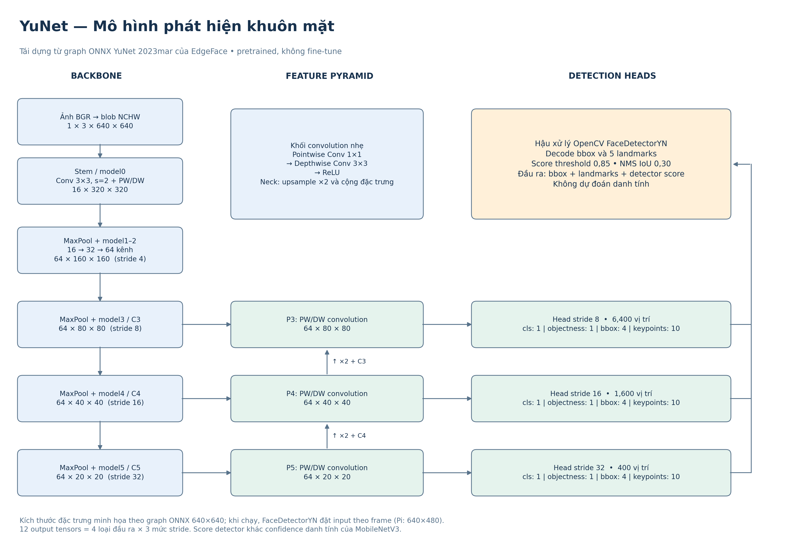
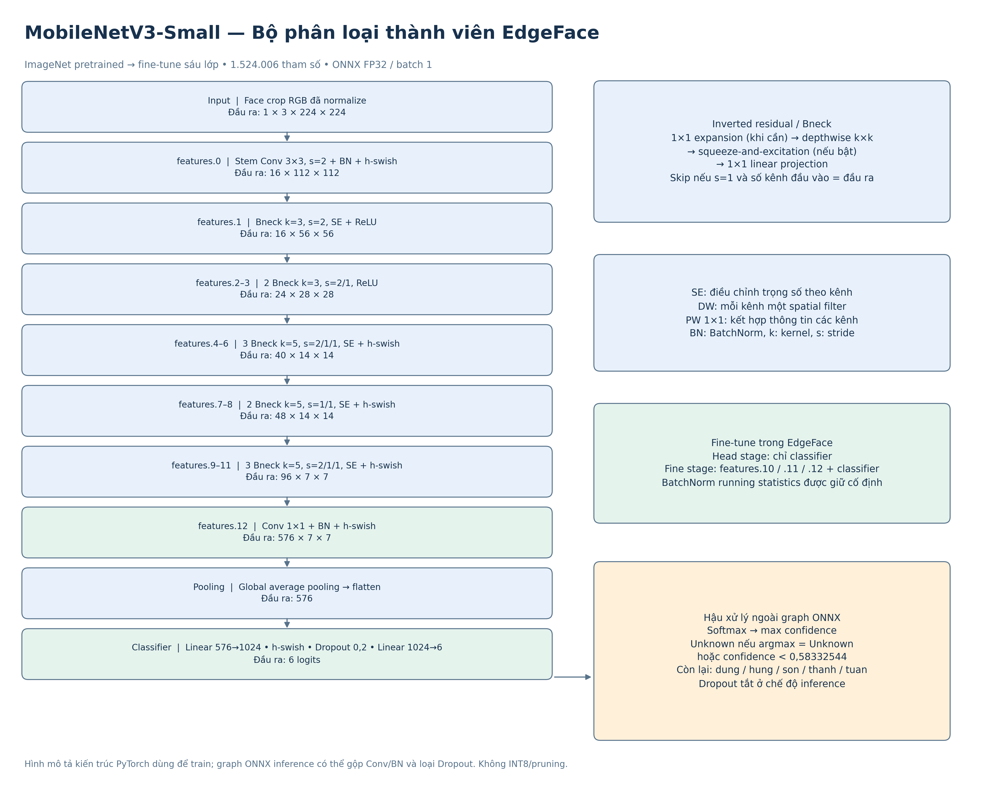
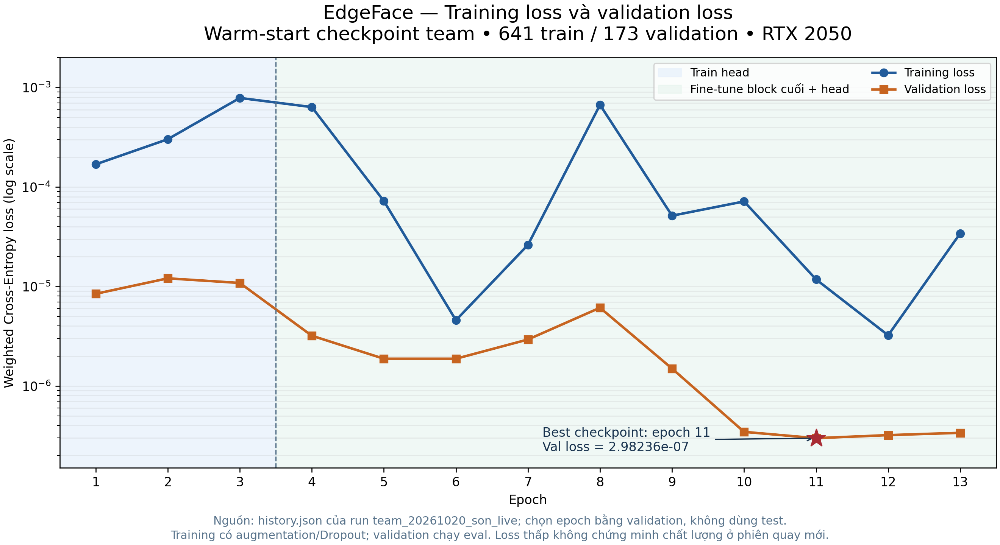
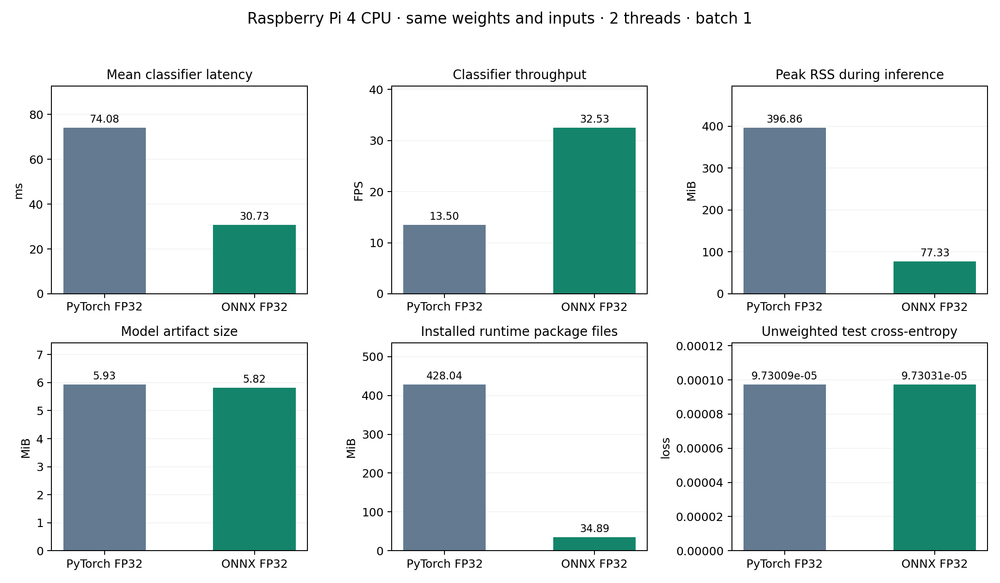
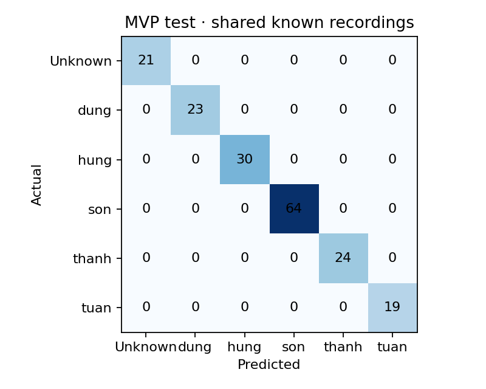
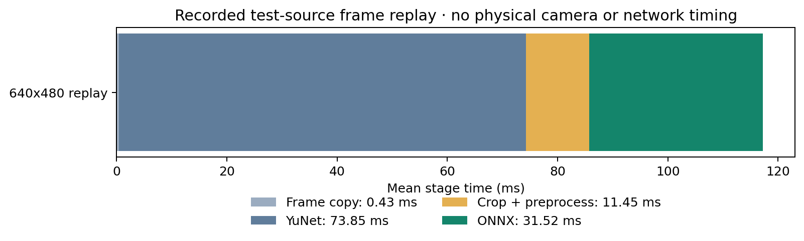

# EdgeFace — Tài liệu tổng hợp hệ thống AIoT nhận diện thành viên

**Mục đích:** tài liệu bàn giao nội bộ để các thành viên hiểu bài toán, kiến trúc, dữ liệu, mô hình và kết quả thực nghiệm; dùng làm nguồn viết báo cáo cuối kỳ 20–35 trang và xây dựng slide. Nội dung phản ánh các phần đã triển khai và đo được, không thay thế báo cáo kết quả thực nghiệm độc lập.

**Trạng thái tham chiếu:** 21/10/2026. Model đang triển khai trên Raspberry Pi: bundle **5010dc47644c**, ONNX **1e170d7902b8**. Benchmark runtime thực hiện ngày 20/10/2026. Dữ liệu khuôn mặt và checkpoint huấn luyện được giữ cục bộ, không đưa vào tài liệu này.

## 1. Tiêu đề

**EdgeFace — Hệ thống nhận diện thành viên bằng Deep Learning trên Raspberry Pi, điều khiển qua Telegram và giao tiếp MQTT**

Đồ án xây dựng một hệ thống AIoT nhận diện một nhóm thành viên đã đăng ký bằng camera USB. Phát hiện khuôn mặt, tiền xử lý và phân loại đều chạy tại Raspberry Pi. Laptop dùng để huấn luyện mô hình, chạy MQTT broker và Telegram Bot. Người dùng bật/tắt thiết bị, xem trạng thái và nhận kết quả qua Telegram; MQTT Explorer cung cấp giao diện quan sát topic trực tiếp.

## 2. Tổng quan bài toán

### 2.1 Bài toán và bối cảnh thực tế

Hệ thống nhận ảnh từ camera, tìm vùng mặt, sau đó phân loại thành một trong năm thành viên đã đăng ký hoặc lớp Unknown. Bài toán mô phỏng một điểm kiểm soát ra vào nhỏ, bảng điểm danh nhóm, hoặc thiết bị chào đón thành viên tại cửa phòng/lab. Đây là mô hình thử nghiệm AIoT; phiên bản hiện tại **không điều khiển khóa cửa, không cấp quyền truy cập vật lý và không thay thế hệ thống an ninh**.

Các khó khăn kỹ thuật gồm thay đổi ánh sáng và góc mặt, nhiều frame video gần như trùng nhau, dữ liệu ít cho mỗi thành viên, người ngoài nhóm không thuộc các lớp đã biết, tài nguyên CPU/RAM hạn chế trên Pi và kết nối mạng thay đổi khi thiết bị được chuyển sang nơi demo khác.

### 2.2 Mục tiêu hệ thống

- Chuẩn bị dữ liệu khuôn mặt từ video thành viên; đồng thời đã thực hiện một phiên thu ảnh thật bằng camera Pi cho Sơn.
- Fine-tune classifier pretrained trên laptop có GPU; chọn ngưỡng Unknown từ tập validation.
- Export classifier sang ONNX và chạy inference bằng ONNX Runtime CPU ngay trên Pi.
- Truyền lệnh, trạng thái, telemetry và kết quả qua MQTT; không truyền video hoặc frame qua MQTT.
- Dùng Telegram như ứng dụng điều khiển và nhận thông báo; MQTT Explorer để quan sát topic.
- Đo chất lượng phân loại, độ trễ, FPS, RAM và kích thước artifact trên cùng Raspberry Pi.

### 2.3 Phạm vi MVP

Model có sáu lớp nội bộ: Unknown, dung, hung, son, thanh và tuan. Trong báo cáo này, các thành viên được gọi ngắn gọn là Dung, Hùng, Sơn, Thanh và Tuấn. Camera chỉ mở khi nhận lệnh start hoặc lệnh thu thập dữ liệu; camera được đóng khi dừng, hoàn tất thu thập hoặc xảy ra lỗi.

Khi Pi dự đoán một thành viên đã biết, Telegram gửi kết quả và dừng phiên nhận diện. Khi dự đoán Unknown, Telegram im lặng và camera tiếp tục chạy. Khi bật thông báo ảnh, kết quả known được gửi dưới dạng tin nhắn và ảnh JPEG có bounding box, tên, confidence. Ảnh không đi qua MQTT. Âm thanh chưa được bật.

## 3. Cơ sở lý thuyết và nghiên cứu liên quan

### 3.1 Phát hiện khuôn mặt và nhận diện danh tính

Phát hiện khuôn mặt xác định vị trí khuôn mặt trong ảnh; nhận diện danh tính dự đoán người trong vùng mặt đó. Hai bước có mục tiêu khác nhau và có thể thất bại riêng biệt. EdgeFace dùng detector YuNet để tìm bounding box và landmarks, sau đó classifier MobileNetV3-Small nhận crop mặt.

YuNet được chọn làm detector pretrained nhẹ, chạy trên OpenCV tại Pi. Nghiên cứu YuNet mô tả detector anchor-free nhỏ dành cho thiết bị biên; OpenCV Zoo cung cấp model ONNX và kết quả đánh giá [bài báo YuNet](https://link.springer.com/article/10.1007/s11633-023-1423-y), [model card của OpenCV Zoo](https://github.com/opencv/opencv_zoo/tree/main/models/face_detection_yunet).

### 3.2 Transfer learning và MobileNetV3-Small

Transfer learning khởi đầu từ trọng số đã học trên tập dữ liệu lớn rồi điều chỉnh một phần mô hình cho dữ liệu mục tiêu nhỏ hơn. Cách này giảm số lượng tham số cần học từ đầu và phù hợp với dữ liệu khuôn mặt của nhóm có quy mô hạn chế.

MobileNetV3 được thiết kế cho giới hạn tài nguyên di động, kết hợp inverted residual, depthwise convolution và các lựa chọn nonlinear hiệu quả. Đồ án dùng MobileNetV3-Small pretrained ImageNet, thay lớp tuyến tính cuối bằng lớp sáu đầu ra. Mô hình có **1.524.006 tham số**. Nghiên cứu gốc trình bày MobileNetV3-Small cho các trường hợp tài nguyên thấp [Howard và cộng sự, ICCV 2019](https://openaccess.thecvf.com/content_ICCV_2019/papers/Howard_Searching_for_MobileNetV3_ICCV_2019_paper.pdf).

Trong training, mô hình học logits cho sáu lớp; softmax chuyển logits thành confidence tương đối. Confidence softmax không phải xác suất đã được hiệu chuẩn thống kê: confidence 0,9 không chứng minh rằng 90% các trường hợp tương tự sẽ được nhận diện đúng.

### 3.3 Unknown và bài toán open-set

Phân loại thông thường giả định ảnh kiểm tra thuộc một trong những lớp đã biết. Trong thực tế, có thể gặp người chưa đăng ký, vì vậy hệ thống thêm lớp Unknown và một ngưỡng từ chối:

1. Nếu lớp có xác suất lớn nhất là Unknown, trả về Unknown.
2. Nếu lớp cao nhất là thành viên nhưng confidence thấp hơn ngưỡng, cũng trả về Unknown.
3. Trường hợp còn lại trả tên thành viên.

Đây là cách tiếp cận open-set baseline đơn giản; nó không bảo đảm xử lý mọi người chưa từng xuất hiện trong huấn luyện. Nghiên cứu open-set recognition nhấn mạnh rằng khi vận hành có thể xuất hiện các lớp không được biết trước [Scheirer và cộng sự, IEEE TPAMI](https://pubmed.ncbi.nlm.nih.gov/23682001/). Lớp Unknown trong đồ án dùng các danh tính LFW tách riêng giữa train/validation/test, nhưng chỉ có 21 ảnh test và khác miền dữ liệu camera Pi.

Một hướng nghiên cứu khác là học embedding rồi so khoảng cách giữa các khuôn mặt. FaceNet dùng embedding Euclidean và triplet loss [Schroff và cộng sự, CVPR 2015](https://www.cv-foundation.org/openaccess/content_cvpr_2015/papers/Schroff_FaceNet_A_Unified_2015_CVPR_paper.pdf). Đồ án hiện **không** dùng embedding similarity làm phương pháp nhận diện chính; classifier sáu lớp phù hợp quy mô nhóm nhỏ và thuận tiện cho quy trình huấn luyện/deploy hiện tại.

### 3.4 ONNX và tối ưu suy luận

ONNX là định dạng biểu diễn graph mô hình giúp tách framework huấn luyện khỏi engine triển khai. PyTorch được dùng để fine-tune; model xuất sang ONNX opset 17, input cố định 1×3×224×224; Pi nạp file bằng ONNX Runtime với CPUExecutionProvider.

ONNX Runtime có thể tối ưu graph lúc tạo session, như constant folding và các phép biến đổi graph tùy cấu hình [tài liệu tối ưu của ONNX Runtime](https://onnxruntime.ai/docs/performance/model-optimizations/). Trong đồ án, export bật constant folding và runtime cấu hình ORT_ENABLE_ALL. Đây là tối ưu định dạng/graph và engine thực thi; **chưa áp dụng pruning, INT8 quantization, FP16 hoặc knowledge distillation**. Hai artifact so sánh runtime đều dùng FP32.

### 3.5 MQTT và mô hình publish/subscribe

MQTT là giao thức publish/subscribe: publisher gửi message tới topic trên broker, broker phân phối cho subscriber có bộ lọc topic phù hợp. Pi và Telegram Bot không cần kết nối trực tiếp với nhau. MQTT 3.1.1 định nghĩa QoS 0 (tối đa một lần), QoS 1 (ít nhất một lần, có thể phát lại) và QoS 2 (đúng một lần trong luồng giao thức MQTT, với thêm handshake) [đặc tả OASIS MQTT 3.1.1](https://docs.oasis-open.org/mqtt/mqtt/v3.1.1/mqtt-v3.1.1.html).

QoS 2 không tự xác thực nguồn lệnh, không mã hóa dữ liệu và không bảo đảm một tác vụ ứng dụng chỉ xảy ra một lần. Vì vậy hệ thống dùng QoS 1 cùng request_id, timestamp/TTL, từ chối retained command, clean session và sổ SQLite chống thực thi lại request ID trên Pi. QoS không được xem là cơ chế mật mã chống replay; broker có tài khoản, ACL và đường kết nối Pi–laptop nằm trong Tailscale.

## 4. Thiết kế kiến trúc hệ thống — Data Pipeline & Architecture

### 4.1 Kiến trúc tổng thể

~~~mermaid
flowchart LR
    subgraph Laptop["Laptop / WSL2 Ubuntu"]
        User["Người dùng"]
        Telegram["Telegram Bot long polling"]
        Broker["Mosquitto MQTT Docker Compose"]
        Explorer["MQTT Explorer localhost:4000"]
        Train["Pipeline training PyTorch + GPU"]
        Deploy["Deploy model SSH over Tailscale"]
        Telegram <--> Broker
        Explorer --> Broker
        Train --> Deploy
    end

    subgraph PiBox["Raspberry Pi 4"]
        Camera["USB Camera CyberTrack H7"]
        YuNet["YuNet Face detection"]
        Preprocess["Crop, align RGB 224x224"]
        Classifier["MobileNetV3-Small ONNX Runtime CPU"]
        Reject["Unknown threshold"]
        MQTTClient["Edge agent MQTT client"]
        Snapshot["Snapshot HTTP RAM cache"]
        Camera --> YuNet --> Preprocess --> Classifier --> Reject
        Reject --> MQTTClient
        Reject --> Snapshot
    end

    User <--> Telegram
    Broker <-->|"MQTT qua Tailscale"| MQTTClient
    Deploy -->|"Model ONNX và metadata"| Classifier
    Snapshot -->|"JPEG annotation qua HTTP riêng trong Tailscale"| Telegram
~~~

Mũi tên kết quả thể hiện metadata được publish lên broker. Ảnh annotation được tải qua endpoint HTTP có token trên Tailscale khi bật tính năng gửi ảnh.

### 4.2 Luồng chuẩn bị dữ liệu và training

~~~mermaid
flowchart LR
    Videos["Video thành viên quay bằng điện thoại"]
    PiCamera["Một phiên thu thật bằng camera Pi cho Sơn"]
    Samples["Lấy mẫu frame đọc orientation video"]
    Detect["YuNet chỉ crop đúng một mặt"]
    Filter["Align và lọc chất lượng blur, sáng, kích thước, duplicate"]
    Split["Chia train / validation / test theo đoạn thời gian, có purge gap"]
    Train["Fine-tune MobileNetV3-Small trên GPU laptop"]
    Calibrate["Chọn ngưỡng Unknown chỉ từ validation"]
    Export["Export ONNX checker + parity"]
    Deploy["Pi: ONNX Runtime CPU"]

    Videos --> Samples
    PiCamera --> Samples
    Samples --> Detect --> Filter --> Split --> Train --> Calibrate --> Export --> Deploy
~~~

### 4.3 Luồng nhận diện và phản hồi

~~~mermaid
sequenceDiagram
    actor User as Người dùng
    participant Bot as Telegram Bot trên laptop
    participant MQTT as Mosquitto
    participant Pi as Raspberry Pi
    participant Camera as Camera

    User->>Bot: /start
    Bot->>MQTT: command start, request_id, timestamp
    MQTT->>Pi: QoS 1 command
    Pi->>Camera: mở camera
    Pi-->>MQTT: status ACK, state recognizing
    MQTT-->>Bot: ACK
    Bot-->>User: Đang nhận diện...
    loop Mỗi vòng lấy mẫu
        Camera->>Pi: frame cục bộ
        Pi->>Pi: YuNet → crop → ONNX → rejection threshold
    end
    alt Nhận diện thành viên
        Pi-->>MQTT: result metadata và image_id
        MQTT-->>Bot: recognition event
        Bot->>MQTT: stop có expected_request_id
        MQTT->>Pi: stop phiên tương ứng
        Pi->>Camera: đóng camera
        Pi-->>MQTT: ACK idle
        MQTT-->>Bot: ACK idle
        Bot-->>User: Tin nhắn kết quả
        Bot->>Pi: HTTP GET ảnh có xác thực qua Tailscale
        Pi-->>Bot: JPEG annotation từ RAM
        Bot-->>User: Tin nhắn ảnh riêng
    else Unknown
        Note over Pi,Bot: Không gửi thông báo Unknown, camera tiếp tục nhận diện
    end
~~~

### 4.4 Thành phần phần mềm

| Thành phần | Nơi chạy | Trách nhiệm |
|---|---|---|
| Telegram Bot | Container trên laptop | Nhận lệnh long polling, publish command lên MQTT, nhận ACK/kết quả, trả lời người dùng |
| Mosquitto | Container trên laptop | MQTT broker; username/password, ACL, LWT và phân phối topic |
| MQTT Explorer | Container trên laptop | UI web chỉ đọc để xem topic/payload; mở tại http://localhost:4000 |
| Edge agent | Python native + systemd trên Pi | Điều khiển camera, detector, classifier ONNX, trạng thái, telemetry và MQTT |
| YuNet | OpenCV DNN trên Pi | Phát hiện khuôn mặt và landmarks |
| MobileNetV3-Small ONNX | ONNX Runtime CPU trên Pi | Classification sáu lớp và Unknown rejection |
| Training/export/evaluation | Python/PyTorch trên laptop | Tách dữ liệu, huấn luyện, hiệu chỉnh threshold, đánh giá, export ONNX |
| Snapshot HTTP endpoint | Pi, chỉ bind Tailnet | Trả JPEG annotation có token; cache trong RAM, không ghi snapshot ra ổ đĩa |

### 4.5 Mạng và triển khai

Mosquitto, Bot và MQTT Explorer được quản lý bằng Docker Compose trên laptop/WSL2. Pi chạy Python native bằng systemd để dùng camera và thư viện hệ thống trực tiếp. Hai máy kết nối qua Tailscale nên luồng liên lạc không phụ thuộc IP DHCP của Wi-Fi demo; broker không mở ra public Internet. SSH cũng đi qua Tailnet khi cần deploy hoặc đọc log.

Pi mở kết nối MQTT tới laptop qua TCP forwarding trong Tailscale. Broker host-side chỉ bind loopback. Không sử dụng SSH tunnel trong cấu hình hiện tại. Telegram Bot dùng long polling nên không cần webhook, public IP hay domain.

## 5. Hạ tầng dữ liệu và giao thức — Data Pipeline

### 5.1 Nguồn dữ liệu

| Nguồn | Nội dung | Số liệu dùng trong revision hiện tại |
|---|---|---|
| Video Dung | dataset/videos/dung/dung.MOV, khoảng 60,65 giây | 71 train / 25 validation / 23 test |
| Video Hùng | dataset/videos/hung/hung.mp4, khoảng 67,39 giây | 92 / 26 / 30 |
| Video Sơn | dataset/videos/son/1.mp4 và 2.mp4, khoảng 17,47 và 61,36 giây | Kết hợp crop video và camera |
| Video Thanh | dataset/videos/thanh/thanh.mp4, khoảng 52,55 giây | 71 / 24 / 24 |
| Video Tuấn | dataset/videos/tuan/tuan.MOV, khoảng 49,96 giây | 73 / 18 / 19 |
| Camera Pi | Một session tự nguyện của Sơn, 150 crop hợp lệ | Thêm 78 train / 19 validation / 26 test; 27 crop bị bỏ do purge gap |
| Unknown | 167 face crops từ 60 danh tính thuộc Labeled Faces in the Wild | 120 train / 26 validation / 21 test; identity disjoint giữa các split |

Các video thành viên do nhóm cung cấp. Dữ liệu Unknown lấy từ LFW công khai, tập ảnh khuôn mặt trong điều kiện không kiểm soát; nghiên cứu gốc tập trung vào face verification [Huang và cộng sự, UMass](https://people.cs.umass.edu/~elm/papers/Huang_eccv2008-lfw.pdf). LFW không đại diện đầy đủ cho người lạ trước camera của nhóm. Nguồn web không được xem là bằng chứng đã có consent cá nhân; ảnh không được phát tán trong Git hoặc slide.

### 5.2 Thu thập và xử lý ảnh

Với video điện thoại, pipeline đọc metadata orientation trước khi giải mã frame; lấy mẫu khoảng mỗi 0,25 giây; chạy YuNet; chỉ giữ frame có đúng một khuôn mặt; căn chỉnh theo mắt khi landmarks phù hợp; mở rộng crop với padding; kiểm tra chất lượng và loại ảnh trùng gần nhau.

Các ngưỡng lọc đã dùng cho dữ liệu video: mặt tối thiểu khoảng 80 px ở ảnh gốc; blur variance dưới 60 trên ảnh tham chiếu 224×224 bị loại; độ sáng mean dưới 35 hoặc trên 220 bị loại; dHash Hamming ≤2 dùng để tìm crop gần trùng. Đây là cấu hình pipeline của dự án, không phải ngưỡng phổ quát cho mọi camera.

Để hạn chế rò rỉ frame gần nhau, mỗi video được chia theo thời gian: 0–50% train, 60–75% validation, 85–100% test; các khoảng 50–60% và 75–85% bị loại. Pipeline tiếp tục loại duplicate qua ranh giới split. Cách làm này tốt hơn chia ngẫu nhiên từng frame, nhưng các tập known vẫn đến từ cùng bản ghi/session. Manifest ghi independent_known_test=false. Unknown được chia theo danh tính, không có người trùng giữa train/validation/test.

Phiên camera Pi cho Sơn ban đầu đàm phán format MJPEG. Decoder Picamera2 trả pixel RGB nhưng code camera cũ giả định BGR, gây đảo kênh đỏ/xanh. Adapter đã được sửa theo pixel format đàm phán thực tế. 150 ảnh gốc của session cũ được giữ nguyên; tạo crop PNG dẫn xuất có đổi kênh và lưu SHA256 nguồn/đích. Không áp dụng phép đổi này cho các session được chụp sau khi sửa code.

Trong phiên thu Sơn, Pi xét thêm 767 frame: 277 bị loại vì chưa đủ khoảng thời gian, 406 gần trùng, 79 không có mặt, 4 mờ và 1 mặt nhỏ. 150 ảnh hợp lệ được lưu cục bộ với quyền hạn chế. Luồng thu có bước xác nhận consent; người ngoài nhóm phải được loại khỏi khung hình và không gán nhãn bằng kết quả model.

### 5.3 Dataset hiện tại và lưu trữ

| Class | Train | Validation | Test | Tổng |
|---|---:|---:|---:|---:|
| Unknown | 120 | 26 | 21 | 167 |
| Dung | 71 | 25 | 23 | 119 |
| Hùng | 92 | 26 | 30 | 148 |
| Sơn | 214 | 54 | 64 | 332 |
| Thanh | 71 | 24 | 24 | 119 |
| Tuấn | 73 | 18 | 19 | 110 |
| **Tổng** | **641** | **173** | **181** | **995** |

Dataset revision dùng trong run hiện tại nằm tại dataset/revisions/team_20261020_son_live/processed; manifest SHA256 bắt đầu bằng e49dc56d. Dữ liệu gốc và crop được giữ cục bộ trong dataset/raw và dataset/revisions; checkpoint training ở runs; bundle inference trong models/releases. Model active được trỏ qua symlink models/active để có thể rollback release.

Ảnh khuôn mặt không được commit lên Git. SQLite trên Pi tại dataset/requests.sqlite3 chỉ lưu request_id và ACK để chống thực thi lặp, không phải kho lịch sử telemetry. Mosquitto đặt persistence=false; trạng thái mới nhất được retained, telemetry định kỳ là message QoS 0. MQTT Explorer hỗ trợ quan sát trực tiếp nhưng hệ thống chưa triển khai InfluxDB/Kafka hoặc cơ sở dữ liệu chuỗi thời gian; do đó chưa có kho lịch sử telemetry dài hạn.

### 5.4 MQTT topics, message và chính sách

Prefix mặc định là aiot/edgeface. Payload JSON có device_id và timestamp UTC ISO-8601; command có request_id UUID. Ví dụ:

~~~json
{
  "request_id": "uuid",
  "device_id": "raspberrypi-01",
  "action": "start",
  "timestamp": "2026-10-20T14:22:16Z"
}
~~~

| Topic | Hướng chính | QoS publish | Retain | Nội dung |
|---|---|---:|---|---|
| aiot/edgeface/command | Bot → Pi | 1 | Không | start, stop, status, members, collect, collect_unknown |
| aiot/edgeface/status | Pi → Bot/UI | 1 | Có cho trạng thái; ACK từng command không retained | online, state, camera, model version, CPU/RAM/nhiệt độ, lỗi, ACK |
| aiot/edgeface/result | Pi → Bot/UI | 1 | Không | recognition, no_face, multiple_faces; confidence và inference time |
| aiot/edgeface/telemetry | Pi → Bot/UI | 0 | Không | số đo định kỳ, mặc định mỗi 10 giây |
| aiot/edgeface/collection | Pi → Bot/UI | 1 | Không | tiến độ và kết quả thu thập dữ liệu |

Command gửi theo QoS 1; recognition/collection event cũng dùng QoS 1; telemetry dùng QoS 0 để tránh tạo backlog khi mất kết nối. MQTT client của Bot và Pi dùng clean session, reconnect tự động theo khoảng tăng dần 1–30 giây, keepalive 30 giây, giới hạn queue 100 message. Khi Pi mất kết nối bất thường, LWT retained gửi trạng thái offline.

Pi từ chối command retained, payload lớn hơn 16 KiB, action không hợp lệ, sai device_id, timestamp hết hạn hoặc lệch clock quá mức và request thiếu consent cho lệnh collect. TTL command mặc định 60 giây; bot timeout chờ ACK mặc định 15 giây. Pi ghi request_id vào SQLite trước khi mở camera/thay đổi trạng thái; request đã xử lý không chạy lại sau reboot. Cách này giảm lỗi lặp do retry/reconnect, nhưng không phải chữ ký số hoặc xác thực mật mã của từng payload.

Broker tắt anonymous access, bật password file và ACL. edgeface_bot chỉ publish command, đọc status/result/telemetry/collection; edgeface_pi chỉ đọc command và publish các topic phản hồi; edgeface_monitor chỉ đọc aiot/edgeface/#. Mật khẩu nằm trong file .env cục bộ và password file đã hash; không đưa secret vào tài liệu.

Ảnh không nằm trong MQTT. Recognition event chỉ mang image_id, content type, kích thước và bbox; Bot tải JPEG từ endpoint giới hạn trong Tailnet bằng token. Đây là HTTP data path riêng, dùng cho tính năng gửi ảnh đã bật.

## 6. Mô hình AI và tối ưu hóa biên — Edge AI

### 6.1 Pipeline inference trên Pi

~~~text
Frame camera 640x480
  → kiểm tra format và chuyển đúng BGR/RGB
  → YuNet phát hiện mặt và landmarks
  → crop mặt, căn chỉnh khi landmark phù hợp
  → chuyển RGB, resize PIL bilinear 224x224
  → scale về [0,1], chuẩn hóa mean/std ImageNet, NCHW float32
  → MobileNetV3-Small ONNX, sáu logits
  → softmax + lớp Unknown hoặc confidence threshold
  → kết quả MQTT; ảnh annotation tùy chọn qua HTTP/Tailscale
~~~

Không phát hiện mặt thì classifier không chạy. Nếu có nhiều mặt, hệ thống không tự chọn hoặc gán nhãn khi thu thập; khi nhận diện sẽ phát event multiple_faces. Preprocessing là một cấu hình dùng chung trong training và inference: RGB, 224×224, PIL bilinear, mean [0.485, 0.456, 0.406], std [0.229, 0.224, 0.225], layout NCHW, float32.

### 6.2 Hai mô hình AI

| Model | Vai trò | Đào tạo trong đồ án | Runtime |
|---|---|---|---|
| YuNet pretrained | Phát hiện mặt, bounding box và landmarks | Không fine-tune | OpenCV DNN CPU trên Pi |
| MobileNetV3-Small pretrained ImageNet | Phân loại Unknown và năm danh tính | Fine-tune trên ảnh khuôn mặt đã crop | ONNX Runtime CPU trên Pi |

Detector và classifier giải quyết hai nhiệm vụ khác nhau. Latency detector chiếm phần lớn thời gian xử lý một frame trong benchmark replay; tối ưu classifier riêng không đồng nghĩa tối ưu toàn pipeline.

### 6.2.1 Kiến trúc YuNet

**Hình 1.** Sơ đồ khối tái dựng từ graph ONNX YuNet 2023mar trong repository: backbone nhẹ, feature pyramid và ba detection head ở stride 8/16/32. Mỗi head có bốn loại đầu ra: classification score, objectness, bbox và năm landmarks (10 tọa độ). Kích thước minh họa theo input graph 640×640; khi vận hành, OpenCV FaceDetectorYN đặt input theo frame thực tế, hiện là 640×480. Ngưỡng detector 0,85 và NMS IoU 0,30 tách biệt với ngưỡng rejection danh tính của classifier.

Bản [SVG YuNet](assets/figures/yunet_architecture.svg) phù hợp đưa vào slide hoặc phóng lớn khi in. Đây là sơ đồ của model triển khai, không sử dụng tốc độ trong bài báo YuNet làm số đo của Pi.

### 6.2.2 Kiến trúc MobileNetV3-Small

**Hình 2.** Backbone MobileNetV3-Small và tensor shape từng nhóm block, pooling và classifier 576→1024→6. Inverted residual kết hợp pointwise expansion, depthwise convolution, squeeze-and-excitation khi có, và linear projection. Skip connection chỉ áp dụng khi stride bằng 1 và số kênh phù hợp. Model có 1.524.006 tham số; softmax và Unknown rejection chạy ở lớp hậu xử lý ngoài graph ONNX. Dropout bị tắt khi inference.

Bản [SVG MobileNetV3-Small](assets/figures/mobilenetv3_small_architecture.svg) và [provenance của các hình](assets/figures/provenance.json) ghi nguồn model, SHA256, tensor shapes và lịch sử training. Các hình được tạo bằng script scripts/render_report_figures.py, không suy diễn kiến trúc từ tên model.

### 6.3 Huấn luyện classifier

Run đầu tạo mô hình sáu lớp từ trọng số ImageNet: thay classifier head; train head khi backbone đóng băng; sau đó mở các block cuối để fine-tune. Run hiện tại tiếp tục từ checkpoint team trước để cập nhật dữ liệu camera Sơn, giữ sáu lớp và cùng preprocessing.

Thông số run hiện tại: seed 42; batch size 16; AdamW; weighted CrossEntropy để giảm ảnh hưởng mất cân bằng lớp; augmentation lật ngang, affine nhẹ và ColorJitter; cố định running statistics của BatchNorm khi train. Train head 3 epoch với learning rate 1e-4, sau đó fine-tune các block cuối và classifier tối đa 10 epoch với learning rate 5e-5; patience 4. GPU thực tế là NVIDIA RTX 2050 4 GiB trên WSL2, CUDA khả dụng. Run mất 107,56 giây, checkpoint tốt nhất tại epoch 11. Trọng số classifier và block cuối đều thay đổi, xác nhận model được cập nhật.

Trên validation mới gồm 173 crop, checkpoint ban đầu có loss 9,06209e-5 và accuracy 100%; checkpoint fine-tune tốt nhất có loss 2,98236e-7 và accuracy 100%. Điều này cho thấy loss validation giảm trong run, không chứng minh generalization tốt hơn ở session độc lập.

**Hình 3.** Loss thực tế qua 13 epoch của run team_20261020_son_live: ba epoch train head và mười epoch fine-tune. Dấu sao đánh dấu checkpoint tốt nhất tại epoch 11, validation loss 2,98236e-7. Trục tung dùng log scale để thể hiện mức loss nhỏ; giữ nguyên toàn bộ điểm đo, không làm mượt. Training sử dụng augmentation/Dropout còn validation chạy eval, nên hai đường loss không nhất thiết có cùng độ lớn. Đây là warm-start từ checkpoint đã train, không phải training từ đầu. Tập test không tham gia chọn epoch.

Nguồn số liệu: [history.json](experiments/team_20261020_son_live/history.json), [training_run.json](experiments/team_20261020_son_live/training_run.json). Bản [SVG training loss](assets/figures/training_loss.svg) dùng để trình bày/in. Loss thấp và accuracy 100% trong cùng phiên không thay thế kiểm thử các phiên quay độc lập.

### 6.4 Hiệu chỉnh Unknown và đánh giá

Ngưỡng rejection hiện tại là **0,5833254400**, được chọn chỉ từ 173 mẫu validation bằng mục tiêu tối đa hóa balanced known/unknown accuracy với ràng buộc FAR validation không quá 5%; không dùng tập test để chọn threshold hoặc checkpoint. Runtime trả Unknown khi argmax là Unknown hoặc confidence lớp cao nhất nhỏ hơn threshold.

Classifier Unknown chỉ học từ danh tính đã có trong tập huấn luyện. Người lạ mới vẫn có thể nhận confidence cao ở lớp thành viên. Cần kiểm thử người lạ thực tế, có ground truth và consent; nếu phân phối camera thay đổi, cần thu dữ liệu mới và hiệu chỉnh threshold bằng validation mới.

### 6.5 Export và tối ưu ONNX

Pipeline export nạp checkpoint PyTorch, kiểm tra checkpoint/threshold/manifest cùng provenance; export fixed input 1×3×224×224, opset 17, ONNX IR 8 và constant folding; chạy ONNX checker; so logits, argmax và quyết định rejection với PyTorch trên cùng input; lưu classes.json, preprocessing.json, threshold.json và export_validation.json cùng model.

Pi sử dụng ONNX Runtime 1.20.1 CPUExecutionProvider, intra-op threads 2; benchmark cấu hình execution sequential và graph optimization ORT_ENABLE_ALL. Đã kiểm tra 181 crop test trên laptop ONNX và Pi ONNX; mọi quyết định giống nhau, sai khác logit tối đa 2,81334e-5, đạt allclose rtol=1e-3, atol=1e-4. ONNX checker passed.

ONNX export không đổi số lớp hay ý nghĩa bài toán. Trọng số vẫn FP32; chưa quantize hoặc prune. Vì vậy khi trình bày cần gọi đây là triển khai ONNX Runtime và graph optimization, không gọi là INT8 quantization.

### 6.6 Lịch sử lỗi camera và cập nhật model

Khi bản model team đầu nhận Sơn nhầm thành Thanh, điều tra cho thấy camera USB đàm phán MJPEG; Picamera2 giải mã ra RGB nhưng adapter cũ xử lý như BGR. Sau khi adapter chuyển đúng theo pixel format đàm phán, trên 26 crop cuối session Sơn: model cũ với màu sai đúng 18/26; chỉ sửa màu đúng 24/26; sửa màu và fine-tune bổ sung đúng 26/26. Đây là chẩn đoán trên cùng session, không tách độc lập; không quy toàn bộ cải thiện cho việc fine-tune.

### 6.7 Đối chứng training đã thực hiện

Đợt training team ban đầu đã so sánh backbone ImageNet đóng băng + head được train với model fine-tune các block cuối. Hai model cùng dùng revision 563 train / 154 validation / 155 test và có threshold calibration riêng.

| Metric trên test revision ban đầu | Head-only | Fine-tune |
|---|---:|---:|
| Accuracy | 155/155 | 155/155 |
| Macro F1 | 1,000 | 1,000 |
| Known-member accuracy | 134/134 | 134/134 |
| Unknown rejection | 21/21 | 21/21 |
| Unknown FAR | 0/21 | 0/21 |

Không có bằng chứng tăng test accuracy từ fine-tune trên revision này vì baseline cũng đạt 100%. Đây là đối chứng training, khác với đối sánh runtime PyTorch/ONNX cùng weights và 181 ảnh hiện tại. Bằng chứng gốc được giữ gọn trong [baseline_team_20261020.json](experiments/baseline_team_20261020.json); báo cáo và đồ thị lặp lại của đợt cũ đã được loại khỏi repository.

## 7. Thiết bị biên và giới hạn phần cứng

| Thiết bị | Thông số đã quan sát | Vai trò |
|---|---|---|
| Laptop/WSL2 | Ubuntu 24.04, x86_64, Python 3.12.14, RAM cấp cho WSL khoảng 7,6 GiB | Training, export, backend, broker, bot, MQTT Explorer |
| GPU laptop | NVIDIA RTX 2050, VRAM 4 GiB; CUDA khả dụng | Fine-tuning MobileNetV3 |
| Raspberry Pi | Raspberry Pi 4, Debian 12 Bookworm, ARM64/aarch64, kernel 6.12.25+rpt-rpi-v8; RAM hệ điều hành báo khoảng 3,7 GiB | Camera capture, YuNet và ONNX Runtime CPU |
| Pi CPU | Bốn core theo phép đo tổng capacity; frequency quan sát 1800 MHz trong benchmark; governor ondemand | Inference CPU-only |
| Camera | USB CyberTrack H7, /dev/video0; driver hỗ trợ mode 640×480 @30 FPS; truy cập thực tế qua libcamera USB, negotiated MJPEG | Thu ảnh và nhận diện local |
| Mạng | Wi-Fi DHCP có thể đổi địa chỉ khi chuyển hotspot; kết nối máy–Pi qua Tailscale | MQTT, SSH và tải ảnh trong Tailnet |

RAM và dung lượng trống là snapshot tại thời điểm kiểm tra, không phải thông số cố định của mọi Pi. Cấu hình đo không có GPU/NPU riêng trên Pi. CPU phải chạy YuNet lẫn classifier; detector là nút thắt lớn hơn classifier. CPU/RAM, nhiệt độ và tốc độ phụ thuộc nguồn điện, tản nhiệt, kernel, phiên bản thư viện, độ sáng và độ phân giải.

Camera hoặc driver hỗ trợ mode 30 FPS không có nghĩa app AI đạt 30 FPS. Benchmark detector + crop + classifier trên replay thấp hơn nhiều. Hệ thống không có liveness detection; ảnh in hoặc ảnh trên màn hình có thể bị nhận diện. Chưa đo điện năng, độ bền thẻ SD, thermal soak dài hạn hoặc độ trễ Internet/Telegram.

## 8. Đo lường định lượng và Benchmark

### 8.1 Phương pháp benchmark

Benchmark chính thực hiện trên **cùng Raspberry Pi**, cùng checkpoint, preprocessing, input float32 và tập test; so PyTorch CPU eager với ONNX Runtime CPU. Mỗi runtime chạy trong process mới để đo RAM riêng; 3 vòng × 200 inference sau 30 warm-up mỗi process, tổng 600 timing/runtime. Thứ tự Torch/ONNX thay đổi qua các vòng. Inference latency bọc forward/session.run; loại đọc ảnh, camera, detector, preprocessing và network.

Ba crop thật từ test được lặp luân phiên để đo latency; toàn bộ 181 crop test được đọc riêng để tính chất lượng/parity. Model không bị train hoặc thay đổi trong benchmark. Pi service được tạm dừng khi đo để tránh cạnh tranh CPU/camera, sau đó bật lại; trạng thái MQTT xác nhận online/idle và camera đóng.

### 8.2 Đối sánh classifier PyTorch và ONNX

| Chỉ số trên Raspberry Pi | PyTorch CPU FP32 | ONNX Runtime CPU FP32 | Thay đổi quan sát |
|---|---:|---:|---:|
| Mean latency | 74,080 ms | 30,732 ms | ONNX nhanh hơn 2,41× |
| P50 latency | 74,331 ms | 30,720 ms | — |
| P95 latency | 75,564 ms | 31,371 ms | — |
| Classifier throughput | 13,497 FPS | 32,529 FPS | Chỉ classifier |
| Model file | 6.218.949 bytes / 5,931 MiB | 6.105.639 bytes / 5,823 MiB | ONNX file nhỏ hơn khoảng 1,82% |
| Model + config bundle | 5,960 MiB | 5,853 MiB | Container/layout khác nhau |
| Warm RSS mean | 395,095 MiB | 76,242 MiB | — |
| Peak RSS trong inference | 396,855 MiB | 77,332 MiB | Giảm khoảng 80,51% |
| Process high-water RSS qua load/warmup/inference | 397,039 MiB | 77,633 MiB | — |
| CPU, theo đơn vị một core | 192,35% | 201,84% | Khoảng 48,09% / 50,46% capacity bốn core |
| Test accuracy | 181/181 = 100% | 181/181 = 100% | Cùng quyết định |
| Macro F1 | 1,000 | 1,000 | Cùng quyết định |
| Unweighted test CrossEntropy | 9,73009e-5 | 9,73031e-5 | Rất gần |

Checkpoint PyTorch có khoảng 5,93 MiB, ONNX khoảng 5,82 MiB. Mức giảm file nhỏ vì so hai định dạng serialization khác nhau, không phải phép nén trọng số đáng kể. Runtime-owned files đo trên Pi: torch+torchvision khoảng 428,04 MiB logical / 460,83 MiB allocated; onnxruntime khoảng 34,89 / 36,17 MiB. Số liệu runtime loại trừ OS và nhiều dependency dùng chung/transitive; cả hai runtime vẫn cài trên Pi nên đây không phải lượng dung lượng SD đã thực sự giải phóng.

### 8.3 Chất lượng nhận diện và parity

| Metric test, 181 crop | Giá trị |
|---|---:|
| Accuracy | 181/181 = 100% |
| Macro F1 | 1,000 |
| Known-member accuracy | 160/160 = 100% |
| Unknown rejection rate | 21/21 = 100% |
| Unknown false acceptance rate | 0/21 trên test này |
| Known false rejection | 0/160 |
| Precision / Recall / F1 từng lớp | 1,000 cho cả sáu lớp trên mẫu test |

Test support: Unknown 21, Dung 23, Hùng 30, Sơn 64, Thanh 24, Tuấn 19. PyTorch Pi và ONNX Pi có argmax agreement 100%, quyết định threshold giống nhau trên 181 mẫu; sai khác logit tuyệt đối tối đa 8,15392e-5. Tập test không được dùng chọn threshold.

**Giới hạn quan trọng:** manifest cho biết independent_known_test=false. Các crop thành viên test đến từ cùng bản ghi/session với dữ liệu train nhưng ở đoạn thời gian giữ lại và có purge gap. Unknown test tách identity nhưng chỉ có 21 ảnh từ 9 danh tính LFW. Vì vậy 100% là kết quả trên test nội bộ hiện tại, không phải ước lượng đáng tin cậy về accuracy với người dùng mới, camera mới hoặc mọi người lạ.

### 8.4 Pipeline replay trên Pi

Theo yêu cầu dùng tập test/dữ liệu sẵn có, benchmark end-to-end vision replay dùng một frame thật trong video Sơn 1 tại mốc khoảng 16 giây, resize giữ tỷ lệ và letterbox về 640×480. 20 warm-up + 200 lượt replay được chạy với OpenCV 4 threads và ONNX Runtime 2 threads. Tất cả 200 lượt có đúng một khuôn mặt. Copy frame trong RAM không phải đo thời gian capture từ sensor.

| Bước xử lý replay | Mean | P50 | P95 |
|---|---:|---:|---:|
| Copy frame RAM | 0,425 ms | 0,424 ms | 0,488 ms |
| YuNet detection | 73,847 ms | 73,351 ms | 78,461 ms |
| Crop/alignment, preprocess và rejection | 11,451 ms | 11,433 ms | 11,645 ms |
| ONNX classifier | 31,516 ms | 31,426 ms | 31,726 ms |
| Vision replay từ frame đến kết quả | 117,239 ms | 116,641 ms | 122,491 ms |

Pipeline replay throughput **8,528 FPS**; peak RSS **121,348 MiB**; process high-water **123,605 MiB**. CPU khoảng 315,11% một core, tương đương 78,78% tổng bốn core. Temperature snapshot tăng từ 59,9°C lên 70,1°C; vcgencmd throttling flags là 0x0 tại hai thời điểm đọc. Đây là replay tính toán không mở camera, không đo gửi MQTT/HTTP/Telegram. Không gọi 8,528 FPS là tốc độ camera live của app.

Tạo bbox/tên/confidence và encode JPEG được đo riêng: 20 lần, mean 15,469 ms, P95 15,937 ms, JPEG trung bình 67.361 bytes. Không đo HTTP qua Tailscale hoặc upload Telegram. App đang chạy còn có frame interval 0,15 giây, cooldown 30 giây và auto-stop sau known; hành vi này khác benchmark continuous replay.

### 8.5 Diễn giải đúng các chỉ số

- **Latency classifier** là thời gian riêng của classifier; không gồm detector/camera/network.
- **FPS classifier** tính theo inference loop, không phải 1/P95 và không phải live camera FPS.
- **Pipeline replay FPS** gồm detector, preprocessing và classifier nhưng không gồm capture vật lý/network.
- **Accuracy/F1/loss** được tính trên 181 test crop đã có; cần test session độc lập trước khi kết luận tổng quát.
- **RAM RSS** là process runtime gồm Python, thư viện, model và buffer; không phải RAM riêng của weights hoặc tổng RAM Pi.
- **Model size** là file trên filesystem; runtime size là footprint package đã cài với phạm vi giới hạn như đã mô tả.
- So sánh PyTorch/ONNX thực hiện trên CPU cùng Pi; không so GPU laptop với CPU Pi.

## 9. Ứng dụng, điều khiển và trực quan hóa

### 9.1 Telegram là ứng dụng điều khiển

Telegram Bot chạy long polling trên laptop. Bot nhận lệnh người dùng, tạo command có request_id/timestamp rồi publish lên MQTT. Pi thực hiện command và trả ACK/status/event qua MQTT; Bot chuyển phản hồi thành tin nhắn. Telegram đóng vai trò ứng dụng điều khiển từ xa và nhận thông báo; inference không chạy ở Telegram hoặc laptop.

| Lệnh | Tác dụng ở mức sử dụng |
|---|---|
| /start | Mở camera và bắt đầu nhận diện cục bộ tại Pi; trả lời “Đang nhận diện...” |
| /stop | Dừng phiên và giải phóng camera |
| /status | Xem state, camera, model version, CPU, nhiệt độ, RAM, inference và lỗi |
| /members | Xem các lớp trong model và các thư mục đã thu |
| /collect &lt;name&gt; | Bắt đầu thu ảnh sau bước xác nhận consent |
| /collect_unknown &lt;anonymous-id&gt; | Thu một session Unknown sau xác nhận participant |
| /help | Xem hướng dẫn lệnh |

Kết quả known gồm tên hiển thị, confidence, thiết bị và inference_ms; Bot gửi về chat đã khởi động request đó. Bot tự gửi lệnh stop có expected_request_id để phiên cũ không dừng nhầm phiên mới. Unknown không gửi tin nhắn/ảnh và không tự dừng; no_face hoặc multiple_faces có thông báo giới hạn theo cooldown. Token Bot và MQTT credentials nằm trong .env, không ghi trong README hoặc report.

Khi recognition photo được bật, Pi vẽ bounding box YuNet, tên tiếng Việt và confidence lên đúng frame nhận diện; snapshot giữ trong RAM tối đa 8 ảnh, TTL mặc định 120 giây. MQTT chỉ mang image_id/metadata; Bot GET JPEG từ endpoint có bearer token trên Tailnet rồi gửi hai tin riêng qua Telegram: text trước, photo sau. Đây là ngoại lệ có chủ đích cho tính năng gửi ảnh; ảnh huấn luyện vẫn được giữ cục bộ. Audio/TTS chưa bật.

Trong cấu hình demo hiện tại, allowlist Telegram user/chat được để trống theo lựa chọn của chủ dự án; khi triển khai cho nhóm lớn hơn nên cấu hình danh sách người được phép trước khi phát tán Bot.

### 9.2 MQTT Explorer là UI quan sát

MQTT Explorer chạy trong Docker Compose profile monitor và mở tại **http://localhost:4000** trên laptop. Có thể bật bằng lệnh sau từ thư mục dự án:

~~~bash
docker compose --profile monitor up -d mqtt-explorer
~~~

Đăng nhập bằng MQTT_EXPLORER_USERNAME và MQTT_EXPLORER_PASSWORD trong file .env cục bộ. UI tự kết nối Mosquitto bằng role edgeface_monitor chỉ đọc aiot/edgeface/#. Có thể xem JSON, trạng thái mới nhất và telemetry theo thời gian thực:

- status: online/offline, idle/recognizing/collecting/error, camera, model, CPU/RAM/nhiệt độ.
- command: lệnh vừa được Bot gửi; chỉ xem được message mới vì command không retained.
- result: recognition, no_face, multiple_faces.
- collection: tiến độ thu ảnh.
- telemetry: số đo định kỳ; UI không thay thế kho lưu lịch sử dài hạn.

MQTT Explorer không hiển thị ảnh/video; ảnh không được truyền trên MQTT. README và docs/MQTT_EXPLORER.md có hướng dẫn chạy UI và kết nối.

### 9.3 Kịch bản demo

1. Mở MQTT Explorer, xác nhận broker và topic status/telemetry của Pi.
2. Gửi /status trên Telegram để cho thấy thiết bị online và model version.
3. Gửi /start; trình bày camera và inference chạy trên Pi. Khi thành viên được nhận diện, quan sát result MQTT, tin nhắn Telegram, auto-stop và ảnh annotation.
4. Thử với người không thuộc nhóm, đã đồng ý tham gia; hệ thống dự kiến im lặng với Unknown và tiếp tục chạy. Ghi nhận ground truth, không giả định mọi người lạ đều bị từ chối.
5. Gửi /stop nếu cần kết thúc phiên và /status để xác nhận camera đóng, state idle.

## 10. Nguồn tham khảo, artifact và hướng phát triển báo cáo

### 10.1 Tài liệu tham khảo

1. Howard, A. et al. (2019). “Searching for MobileNetV3.” Proceedings of the IEEE/CVF International Conference on Computer Vision (ICCV), pp. 1314–1324. [Bài báo](https://openaccess.thecvf.com/content_ICCV_2019/papers/Howard_Searching_for_MobileNetV3_ICCV_2019_paper.pdf).
2. Wu, W., Peng, H., & Yu, S. (2023). “YuNet: A Tiny Millisecond-level Face Detector.” Machine Intelligence Research, 20(5), 656–665. [Bài báo](https://link.springer.com/article/10.1007/s11633-023-1423-y), [OpenCV Zoo implementation/model card](https://github.com/opencv/opencv_zoo/tree/main/models/face_detection_yunet).
3. Schroff, F., Kalenichenko, D., & Philbin, J. (2015). “FaceNet: A Unified Embedding for Face Recognition and Clustering.” Proceedings of the IEEE Conference on Computer Vision and Pattern Recognition (CVPR), pp. 815–823. [Bài báo](https://www.cv-foundation.org/openaccess/content_cvpr_2015/papers/Schroff_FaceNet_A_Unified_2015_CVPR_paper.pdf).
4. Scheirer, W. J., de Rezende Rocha, A., Sapkota, A., & Boult, T. E. (2013). “Toward Open Set Recognition.” IEEE Transactions on Pattern Analysis and Machine Intelligence, 35(7), 1757–1772. DOI: 10.1109/TPAMI.2012.256. [PubMed record](https://pubmed.ncbi.nlm.nih.gov/23682001/).
5. Huang, G. B., Mattar, M., Berg, T., & Learned-Miller, E. (2008). “Labeled Faces in the Wild: A Database for Studying Face Recognition in Unconstrained Environments.” European Conference on Computer Vision (ECCV). [Bài báo và mô tả dataset](https://people.cs.umass.edu/~elm/papers/Huang_eccv2008-lfw.pdf).
6. OASIS (2014). “MQTT Version 3.1.1.” [Đặc tả chuẩn](https://docs.oasis-open.org/mqtt/mqtt/v3.1.1/mqtt-v3.1.1.html).
7. ONNX Runtime. “Model optimizations” và “Thread management.” [Tối ưu graph/quantization](https://onnxruntime.ai/docs/performance/model-optimizations/), [cấu hình thread](https://onnxruntime.ai/docs/performance/tune-performance/threading.html).
8. Open Neural Network Exchange. “ONNX Concepts.” [Tài liệu định dạng ONNX](https://onnx.ai/onnx/intro/concepts.html).

### 10.2 Tài liệu và artifact nội bộ

| Nội dung | File trong repository |
|---|---|
| Kiến trúc MVP và triển khai | docs/ARCHITECTURE.md |
| Đối chứng head-only/fine-tune, revision trước | report/experiments/baseline_team_20261020.json |
| Sửa pixel format camera và fine-tune hiện tại | report/experiments/team_20261020_son_live/ |
| Benchmark runtime, replay, RAM và model size | report/BENCHMARK_20261020.md |
| Theo dõi MQTT Explorer | docs/MQTT_EXPLORER.md |
| Ảnh annotation gửi Telegram | docs/PHOTO_NOTIFICATIONS.md |
| Môi trường đã kiểm tra | docs/ENVIRONMENT.md |
| Đồ thị training/validation loss mới, PNG/SVG | report/assets/figures/training_loss.png |
| Ảnh kiến trúc YuNet, MobileNetV3-Small | report/assets/figures/ |
| Confusion matrix | report/assets/team_20261020_son_live/confusion_matrix.png |
| So sánh PyTorch/ONNX/RAM/model size | report/assets/benchmark_team_20261020/runtime_comparison.png |
| Breakdown replay vision | report/assets/benchmark_team_20261020/pipeline_stages.png |
| Số liệu JSON benchmark | report/experiments/benchmark_team_20261020/ |
| Manifest, metrics và provenance model hiện tại | report/experiments/team_20261020_son_live/ |

Các module chính: training/data.py, training/train.py, training/evaluate.py, training/export_onnx.py; edgeface/preprocess.py, edgeface/protocol.py, edgeface/mqtt.py; raspberry_pi/camera.py, detection.py, inference.py, agent.py, snapshots.py; telegram_bot/bot.py. Raw face dataset và checkpoint huấn luyện là dữ liệu riêng, không commit.

### 10.3 Gợi ý mở rộng thành báo cáo 20–35 trang

| Chương báo cáo cuối kỳ | Nội dung có thể phát triển | Trang tham khảo |
|---|---|---:|
| Mở đầu, động lực, bài toán | Ngữ cảnh, mục tiêu, phạm vi, yêu cầu môn học | 2–3 |
| Cơ sở lý thuyết, nghiên cứu liên quan | Face detection/recognition, transfer learning, MobileNetV3, Unknown/open-set, MQTT, ONNX | 4–6 |
| Kiến trúc và data pipeline | Diagram, thành phần, topic, QoS, ACL, flow thu thập | 4–6 |
| Dataset và phương pháp huấn luyện | Nguồn, lọc, split, leakage, augmentation, training strategy | 3–5 |
| Edge deployment và ứng dụng | Pi, camera, ONNX Runtime, Tailscale, Telegram, MQTT Explorer | 3–4 |
| Thực nghiệm và benchmark | Chất lượng test, latency/FPS, RAM/Flash, biểu đồ và phương pháp | 4–6 |
| Thảo luận, giới hạn, đạo đức | Test session độc lập, Unknown, consent, liveness, dữ liệu cá nhân | 2–3 |
| Kết luận và hướng phát triển | Kết quả đạt được và kế hoạch cải thiện có thể kiểm thử | 1–2 |

Gợi ý slide 10–14 trang: vấn đề và mục tiêu; kiến trúc; luồng dữ liệu; YuNet + MobileNetV3; training và split; ONNX/edge deployment; MQTT topics/QoS; demo Telegram/UI; confusion matrix; benchmark latency/memory; giới hạn và kết luận.

### 10.4 Kết quả có thể khẳng định và giới hạn cần giữ

- Có pipeline chạy thực tế từ video thành viên và có 150 crop Sơn được chụp trực tiếp bởi camera Pi; không nên nói toàn bộ dataset được thu từ Pi.
- Fine-tune thực sự cập nhật classifier và backbone cuối bằng GPU laptop; model ONNX chạy local trên Pi ARM64 CPU.
- Trên test nội bộ 181 ảnh, cả PyTorch và ONNX đạt accuracy 100%, macro F1 1,000 và parity quyết định 100%; benchmark cho thấy ONNX classifier mean nhanh hơn 2,41× và peak inference RSS thấp hơn 80,51% trên cùng Pi.
- Known test dùng chung source recording/session với train; Unknown test có 21 ảnh từ 9 danh tính LFW. Cần thu thêm session độc lập cho tất cả thành viên và người lạ đồng ý tham gia trước khi kết luận chất lượng ngoài thực tế.
- Benchmark replay không phải live-camera benchmark; chưa đo network/Telegram latency, công suất, thermal soak dài, INT8/pruning hoặc liveness detection.
- Telegram/MQTT Explorer hỗ trợ điều khiển và quan sát; hiện chưa có time-series database lưu telemetry dài hạn và chưa có cơ cấu chấp hành khóa cửa.
- Ảnh sinh trắc học là dữ liệu nhạy cảm: chỉ thu thập khi người tham gia đồng ý, giới hạn quyền truy cập, có cơ chế xóa session, không gửi ảnh ngoài luồng snapshot đã bật và không đưa ảnh thô vào Git/slides công khai.

Các số liệu benchmark trong tài liệu này là phép đo trên thiết bị và dataset đã ghi. Khi có dữ liệu các thành viên từ phiên mới, nên tạo revision dataset mới, lặp lại training/calibration/evaluation với split theo session độc lập, export/deploy model mới và chạy lại benchmark Pi trước khi thay kết luận trong báo cáo cuối kỳ.
