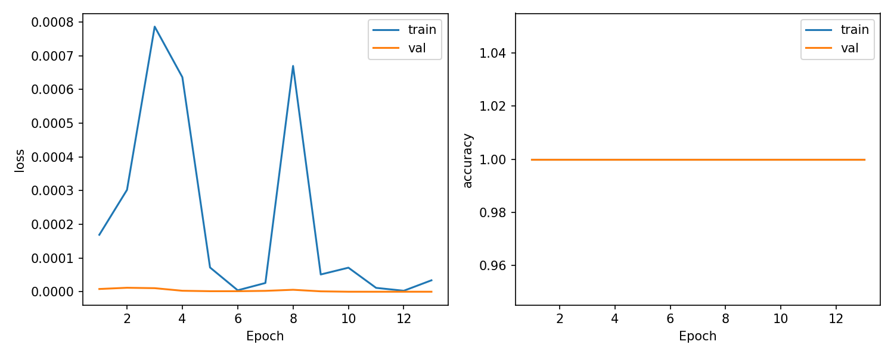

# EdgeFace — Bổ sung dữ liệu camera Sơn và sửa nhận nhầm

Ngày 20/10/2026. Release hiện tại **`5010dc47644c`**, ONNX **`1e170d7902b8`**. Đây là cập nhật sau [release team đầu tiên](TEAM_TRAINING_20261020.md), khi người dùng phản ánh Sơn bị nhận nhầm thành Thanh trên Telegram.

## Thu thập thực tế

Đã viết và chạy `scripts/collect_member.py` trên laptop. Script gửi command MQTT có consent/request ID, đợi ACK và tiến độ; Pi trực tiếp mở camera, YuNet phát hiện/căn chỉnh/crop mặt, lọc chất lượng và lưu ảnh cục bộ. Không dùng prediction của classifier để tự gán nhãn. Nhãn `son` do chính người tham gia yêu cầu trong phiên thu.

```bash
.venv/bin/python -m scripts.collect_member --name son --target 150 --timeout 300 --consent --stop-first
```

- Request: `c08f0ea6-f2af-47b9-a90d-cb961909357c`.
- Session: `b86354bcfd8a4a6b95f178a87319bfcd`.
- **150 ảnh hợp lệ**, hoàn tất lúc 14:13:50 UTC; camera tự đóng.
- Bỏ 767 frame: 277 chưa đủ khoảng cách thời gian, 406 gần trùng, 79 không có mặt, 4 mờ, 1 mặt quá nhỏ. Các frame bị bỏ không được lưu làm dữ liệu train.
- Dữ liệu gốc: Pi và laptop `dataset/raw/son/b86354bcfd8a4a6b95f178a87319bfcd/`, quyền thư mục 700/file 600; không đưa lên Git hoặc Telegram.

## Nguyên nhân màu ảnh và bản sửa

Camera CyberTrack H7 qua libcamera thực tế **đàm phán format MJPEG**, dù code yêu cầu RGB888. Đã kiểm tra `camera_configuration()["main"]["format"]` trên Pi, kết quả `MJPEG`.

Mã Picamera2 đang cài tại Pi, `/usr/lib/python3/dist-packages/picamera2/request.py`, nhánh MJPEG giải mã bằng `np.array(Image.open(...))`, cho array **RGB**. Nhánh RGB888 thông thường lại có byte order BGR. Code cũ giả định mọi `capture_array()` đều BGR, nên MJPEG bị đảo kênh đỏ/xanh khi detector, lưu JPEG và classifier sử dụng ảnh. Điều này làm màu khuôn mặt khác dữ liệu video, gây domain shift có thể tái hiện trên ảnh Sơn.

`raspberry_pi/camera.py` hiện đọc **format đã đàm phán**, chuyển MJPEG/BGR888 từ RGB sang BGR trước YuNet, giữ RGB888 BGR đúng như cũ và xử lý rõ cả hai format bốn kênh. Format chưa hỗ trợ bị báo lỗi thay vì âm thầm dùng sai. V4L2/OpenCV tiếp tục dùng BGR. Metadata phiên mới lưu format thực và quy ước màu.

150 crop vừa thu thuộc pipeline cũ. Đã giữ nguyên ảnh gốc, tạo bản dẫn xuất **PNG lossless từ crop đã giải mã**, đổi hai kênh và lưu SHA256 nguồn/đích. Bước này không phục hồi thông tin đã mất do JPEG trước đó. `training.import_camera_session` chỉ sửa khi có cờ rõ ràng `--swap-red-blue`; **không dùng cờ này cho các phiên camera sau bản sửa**.

## Chia tập và training bổ sung

Dùng đoạn thời gian 0–50% train, 60–75% validation, 85–100% test của một phiên camera; bỏ hai khoảng đệm. Kết quả: **78 train / 19 validation / 26 test / 27 bỏ theo khoảng đệm**. Ba nhóm vẫn giữ cùng `source_recording`, không giả làm ba phiên độc lập.

Replay toàn bộ dữ liệu revision trước của cả nhóm để giảm quên các lớp khác. Dataset mới `dataset/revisions/team_20261020_son_live/processed`:

| Class | Train | Validation | Test |
|---|---:|---:|---:|
| Unknown | 120 | 26 | 21 |
| dung | 71 | 25 | 23 |
| hung | 92 | 26 | 30 |
| son | 214 | 54 | 64 |
| thanh | 71 | 24 | 24 |
| tuan | 73 | 18 | 19 |
| **Tổng** | **641** | **173** | **181** |

Fine-tune MobileNetV3-Small từ checkpoint team `runs/team_20261020/best_model.pth`, giữ đúng sáu lớp và preprocessing RGB 224×224/ImageNet. Train head 3 epoch LR 1e-4, sau đó 10 epoch mở các block cuối LR 5e-5; AdamW, class-weighted CrossEntropy, batch 16, seed 42, augmentation, BatchNorm statistics cố định, chọn checkpoint theo validation loss.

GPU thực chạy RTX 2050. Training **107,56 giây**, best epoch **11**, validation loss **2,98236e-7**. Max thay đổi trọng số classifier **0,00710683**, block backbone theo dõi **0,00400233**, xác nhận có cập nhật trọng số thật. Ngưỡng **0,5833254400** chọn bằng 173 ảnh validation; không dùng test để chọn ngưỡng/checkpoint.



## Đối sánh trên ảnh giữ lại

So sánh cùng **26 ảnh Sơn** ở đoạn cuối chưa dùng train hoặc validation:

| Pipeline | Đúng Sơn | Nhầm Thanh | Nhầm Tuấn | Unknown |
|---|---:|---:|---:|---:|
| Model cũ, màu camera sai | 18 | 5 | 2 | 1 |
| Model cũ, chỉ sửa màu | 24 | 0 | 0 | 2 |
| Sửa màu và fine-tune bổ sung | 26 | 0 | 0 | 0 |

Sửa màu giải quyết phần lớn lỗi của phiên này. Không quy toàn bộ cải thiện cho training. Chẩn đoán màu ban đầu dùng 40 ảnh ở đầu phiên, tách khỏi 26 ảnh test cuối phiên. Nhãn test là Sơn do người tham gia đã xác nhận mục đích phiên thu, không lấy từ prediction model.

Tập test hợp nhất đạt **181/181**, gồm 155 ảnh test cũ và 26 ảnh camera mới; macro F1 **1,000**, known **160/160**, Unknown rejection **21/21**, FAR **0/21**. Precision/recall/F1 của sáu lớp đều 1 trên chính tập này. Bản model cũ với màu đã sửa vẫn đạt validation accuracy 100% trên revision mới; không dùng kết quả loss thấp hơn để tuyên bố bảo đảm tốt hơn ở mọi điều kiện.


**Giới hạn:** đây vẫn là các đoạn từ cùng phiên quay, có tương quan về môi trường và tư thế; `independent_known_test=false`. Chưa đo accuracy trên phiên camera độc lập. Chỉ Sơn có dữ liệu Pi, các thành viên khác cần thử lại bằng camera sau sửa màu. Unknown vẫn là ảnh web có danh tính tách riêng; không suy diễn FAR thực tế bằng 0. Không có liveness detection.

## ONNX và triển khai đã kiểm chứng

- FP32, fixed input 1×3×224×224, opset 17/IR 8, ONNX checker passed.
- PyTorch CPU ↔ ONNX CPU: 173 input validation, argmax/rejection agreement 100%; max absolute logit difference **9,63211e-5**.
- Laptop ONNX ↔ Pi ARM64 ONNX: **181 input test**, mọi quyết định giống nhau, logits đạt allclose rtol 1e-3/atol 1e-4; max difference **2,81334e-5**.
- ONNX **6.105.639 bytes**. Pi ONNX Runtime 1.20.1 CPU, 2 threads; thời gian `session.run` trong phép kiểm tra test sau 20 warmup: mean **30,362 ms**, P50 **30,114 ms**, P95 **30,733 ms**. Đây là đo kiểm xác minh classifier, chưa phải benchmark dài hạn/FPS toàn camera hoặc đối sánh tối ưu hóa.
- Pi và laptop `models/active` trỏ `releases/5010dc47644c`; release `024f31fdc9b8` giữ để rollback model. Code sửa màu được triển khai riêng, không cần rollback cùng model.
- Đã restart systemd, kiểm tra MQTT `/members`, start/status/stop: Pi nạp đúng bundle mới, mở camera `libcamera_usb`, inference local, không có lỗi, stop về idle và đóng camera. ACK status ngay sau restart lần đầu timeout do chưa sẵn sàng MQTT; lần kiểm tra lại và chuỗi start/status/stop đều thành công.
- Bot vẫn hiển thị Nguyễn Hồ Trường Sơn, Unknown im lặng; known gửi tin nhắn và auto-stop. Không bật âm thanh.

Đã chạy **43 automated tests passed**, gồm camera pixel-order regression, giữ nguyên dữ liệu nguồn/provenance khi import, no-face, multiple faces, Unknown và replay request. Ảnh dùng trong unit tests chỉ là fixture kiểm tra code, không tham gia training hoặc số liệu model.

## Artifacts và tái sử dụng

Script thu: `scripts/collect_member.py`. Import phiên đã đồng bộ:

```bash
.venv/bin/python -m training.import_camera_session dataset/raw/son/b86354bcfd8a4a6b95f178a87319bfcd --dataset dataset/revisions/<new_revision> --swap-red-blue
```

Lệnh trên chỉ dành cho session legacy nêu trong báo cáo, và revision mới phải chứa dữ liệu cũ cần replay trước khi chia tập. Không import lặp session vào revision đã dùng.

Checkpoint/lịch sử đầy đủ: `runs/team_20261020_son_live/`. Metadata tổng hợp không chứa ảnh: [experiments/team_20261020_son_live](experiments/team_20261020_son_live/). `camera_comparison.json` lưu đối sánh pipeline, `deployment.json` chứa ACK thực tế. Không commit raw crops, prediction example có khuôn mặt hoặc secrets.

Manifest SHA256: `e49dc56d80cda94e6f5132d613b972d0db4f8dfd8ea9b987a1dc777a2b2f88dd`.

Checkpoint SHA256: `af8fcef57f90d4315347b0c0a72c06cc0d25d636ed0c1675e5a305b2015d8175`.

ONNX SHA256: `1e170d7902b8836209030c3f9e166dfa1c31bc42a570e37d82294e80d6d15f81`.
