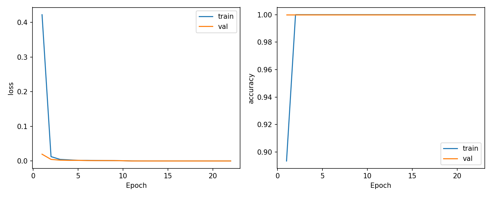
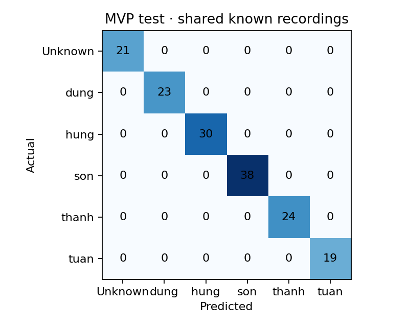

# EdgeFace — Training, đánh giá và triển khai cả team

Đây là kết quả release team ban đầu. Bản sửa màu camera và bổ sung ảnh Sơn được ghi riêng trong [SON_CAMERA_UPDATE_20261020.md](SON_CAMERA_UPDATE_20261020.md).

Ngày thực hiện: **20/10/2026**. Release đầu tiên đã kiểm chứng trên Raspberry Pi: **`024f31fdc9b8`**, ONNX **`409a4b48a74f`**.

Đã train classifier 5 thành viên + Unknown, export ONNX, đối chiếu cùng input trên laptop/Pi, kiểm tra camera thật và MQTT. Test hiện tại đạt **155/155 ảnh**, nhưng **các ảnh thành viên vẫn đến từ những video có đoạn dùng để train**. Kết quả này là đánh giá theo đoạn thời gian trong cùng phiên quay; chưa chứng minh accuracy ở một phiên quay hoặc điều kiện camera mới.

## 1. Dữ liệu thực tế đã sử dụng

| Label | Tên hiển thị | Video được cung cấp | Thời lượng |
|---|---|---|---:|
| `dung` | Dung | `dataset/videos/dung/dung.MOV` | 60,65 s |
| `hung` | Hùng | `dataset/videos/hung/hung.mp4` | 67,39 s |
| `son` | Nguyễn Hồ Trường Sơn | `dataset/videos/son/1.mp4`, `2.mp4` | 17,47 + 61,36 s |
| `thanh` | Thanh | `dataset/videos/thanh/thanh.mp4` | 52,55 s |
| `tuan` | Tuấn | `dataset/videos/tuan/tuan.MOV` | 49,96 s |
| `Unknown` | Unknown | 167 crop thật từ 60 danh tính LFW đã lưu cục bộ | Ảnh tĩnh |

Không tạo dữ liệu huấn luyện giả. Unknown tái sử dụng nguồn LFW funneled đã có checksum/provenance từ lần chuẩn bị trước; không tải ảnh tùy ý hoặc tự xác nhận consent của những người trong LFW. Nguồn: [LFW archive](https://ndownloader.figshare.com/files/5976015), SHA256 `b47c8422c8cded889dc5a13418c4bc2abbda121092b3533a83306f90d900100a`. Ảnh/video giữ cục bộ, không đưa lên Git hoặc Telegram.

Video thành viên được dùng theo yêu cầu cung cấp dữ liệu của nhóm. Nguồn training hiện tại là video do nhóm quay, chưa phải dataset thu bằng camera IoT trên Pi.

## 2. Tách ảnh và chống leakage

Importer đọc metadata xoay của điện thoại trước khi phát hiện mặt: Dung/Hùng/Thanh cần xoay 270°, Tuấn 90°, Sơn 0°. OpenCV trong môi trường này không tự áp dụng rotation mặc định; đã sửa importer để đưa frame về đúng hướng một lần trước YuNet. Có test cho các góc 0/90/180/270°.

Pipeline video: lấy mẫu khoảng 0,25 s → YuNet ở cạnh dài tối đa 640 px → chỉ nhận đúng một mặt → căn chỉnh theo mắt khi landmarks phù hợp → crop có padding → kiểm tra chất lượng. Lọc mặt nhỏ hơn 80 px ở ảnh gốc, blur variance dưới 60 trên ảnh tham chiếu 224×224, độ sáng ngoài 35–220 và crop gần trùng với dHash Hamming ≤ 2.

Từ 940 frame được xét sau lấy mẫu/bỏ khoảng đệm, giữ 735 crop thành viên; bỏ 204 crop gần trùng và 1 crop mờ. Cộng 167 ảnh Unknown có 902 ảnh raw. Audit không tìm thấy ảnh hỏng hoặc bản trùng SHA256; bước chia tập bỏ thêm 30 crop gần trùng qua ranh giới split. Còn **872 ảnh**:

| Class | Train | Validation | Test |
|---|---:|---:|---:|
| Unknown | 120 | 26 | 21 |
| dung | 71 | 25 | 23 |
| hung | 92 | 26 | 30 |
| son | 136 | 35 | 38 |
| thanh | 71 | 24 | 24 |
| tuan | 73 | 18 | 19 |
| **Tổng** | **563** | **154** | **155** |

Mỗi video dùng đoạn 0–50% cho train, 60–75% cho validation và 85–100% cho test. Hai khoảng 50–60% và 75–85% bị bỏ. Không trộn ngẫu nhiên các frame kề nhau giữa các tập. Tuy nhiên cùng một phiên vẫn có ánh sáng, camera và tư thế tương quan; không gọi đây là test độc lập theo phiên.

Unknown chia theo danh tính: **42 train / 9 validation / 9 test**, không có danh tính giao nhau. Metadata ghi rõ `independent_known_test=false` và `unknown_identity_disjoint=true`.

Dataset revision cục bộ: `dataset/revisions/team_20261020/processed`. Manifest SHA256: `3a1a1be6375fa48175c8c39167bbe36eeaaa3795f5c7c5d06c6ab8d59c20c493`.

## 3. Model và training

- MobileNetV3-Small pretrained ImageNet `IMAGENET1K_V1`, thay lớp Linear cuối bằng 6 output: `Unknown`, `dung`, `hung`, `son`, `thanh`, `tuan`.
- Train mới từ ImageNet; không dùng trực tiếp head hai lớp của model Sơn cũ cho bài toán sáu lớp.
- Input RGB 224×224, PIL bilinear, chia 255 và chuẩn hóa ImageNet mean/std. Training dùng thêm flip, affine nhẹ và ColorJitter. Resize về kích thước model trước augmentation để tránh xử lý các crop điện thoại nhiều megapixel trên CPU.
- Head stage: đóng băng backbone, tối đa 10 epoch, LR `1e-3`.
- Fine stage: mở `features.10`, `features.11`, `features.12` cùng classifier, tối đa 20 epoch, LR `1e-4`. Giữ BatchNorm running statistics cố định.
- AdamW, weight decay `1e-4`; CrossEntropy có class weights; batch 16; seed 42; 2 DataLoader workers; early stopping patience 5 theo validation loss.

Môi trường thực chạy: Python 3.12.14, PyTorch 2.14.0+cu130, torchvision 0.29.0+cu130, NVIDIA RTX 2050 4 GiB. Không báo phiên bản thực nghiệm là bộ pin PyTorch 2.5.1 trong cấu hình cài đặt dự kiến.

Run hoàn tất **22 epoch**: 10 head + 12 fine; early stopping chọn **epoch 17**, stage fine. Thời gian training hoàn tất là **196,07 s**, không bao gồm tách video, export hoặc triển khai.

| Chỉ số | Kết quả |
|---|---:|
| Validation accuracy checkpoint tốt nhất | 100% |
| Validation loss checkpoint tốt nhất | 0,0000021084 |
| Validation loss baseline head-only | 0,0007148177 |
| Max absolute update classifier so với khởi tạo | 0,04704377 |
| Max absolute update block backbone được theo dõi | 0,00532097 |

Các thay đổi trọng số xác nhận model thực sự được train/fine-tune. Baseline là backbone ImageNet đóng băng + head đã được train (`best_head.pth`), có calibration riêng. Không dùng classifier ImageNet nguyên bản hoặc head ngẫu nhiên làm baseline nhận diện danh tính.



## 4. Calibration và test

Ngưỡng chọn trên **154 ảnh validation**, tối ưu balanced known/unknown accuracy với ràng buộc FAR validation ≤ 5%; tie-break theo known accuracy rồi ngưỡng midpoint bảo thủ. Model fine-tune chọn **0,5832735009**; baseline chọn **0,5708061456**. Cả hai đạt FAR validation thực nghiệm 0/26. Không dùng test để chọn threshold, checkpoint hoặc hyperparameter.

Runtime trả Unknown khi class argmax là Unknown hoặc max softmax thấp hơn threshold. Softmax confidence không phải xác suất danh tính đã được hiệu chuẩn thống kê.

| Metric test | Baseline head-only | Fine-tune |
|---|---:|---:|
| Accuracy | 100% | 100% |
| Macro F1 | 1,000 | 1,000 |
| Known-member accuracy | 134/134 | 134/134 |
| Unknown rejection rate | 21/21 | 21/21 |
| Unknown false acceptance rate | 0/21 | 0/21 |
| Known false rejection rate | 0/134 | 0/134 |

**Không có bằng chứng tăng accuracy từ fine-tuning trên tập test này**, vì baseline cũng đạt 100%. Fine-tuning giảm validation loss và cập nhật các block cuối; không suy diễn rằng nó đã tốt hơn ở camera/phiên mới. Unknown test chỉ có 21 ảnh từ 9 danh tính; FAR 0 là point estimate của mẫu nhỏ, không phải bảo đảm mọi người lạ đều bị từ chối.

| Class | Precision | Recall | F1 | Test support |
|---|---:|---:|---:|---:|
| Unknown | 1,000 | 1,000 | 1,000 | 21 |
| dung | 1,000 | 1,000 | 1,000 | 23 |
| hung | 1,000 | 1,000 | 1,000 | 30 |
| son | 1,000 | 1,000 | 1,000 | 38 |
| thanh | 1,000 | 1,000 | 1,000 | 24 |
| tuan | 1,000 | 1,000 | 1,000 | 19 |



Prediction CSV và ảnh minh họa nằm trong `runs/team_20261020/evaluation/`, chỉ giữ cục bộ. Test không có dự đoán sai, nên không tạo ví dụ sai giả.

## 5. Export ONNX và xác minh trên Pi

Bundle gồm `face_classifier.onnx`, `classes.json`, `preprocessing.json`, `threshold.json`, `export_validation.json`. Model FP32, input cố định `1×3×224×224`, opset 17, ONNX IR 8. Chưa thực hiện INT8 hoặc pruning trong run này.

| Kiểm tra thực chạy | Kết quả |
|---|---|
| ONNX checker | Passed |
| PyTorch CPU ↔ ONNX CPU, cùng 154 input validation | 100% argmax và rejection agreement |
| Max absolute logit difference PyTorch ↔ ONNX | 0,0000534058 |
| Laptop ONNX ↔ Pi ONNX, cùng 155 ảnh test | 100% decision agreement, allclose passed |
| Max absolute logit difference laptop ↔ Pi | 0,0000243187 |
| Pi architecture / runtime | aarch64 / ONNX Runtime 1.20.1 CPUExecutionProvider |
| Kích thước ONNX | 6.105.639 bytes, khoảng 5,82 MiB |
| Pi classifier latency mean / P50 / P95 | 30,643 / 30,558 / 30,932 ms |
| RSS tiến trình kiểm tra trên Pi | 101,65 MiB |

Số latency trên Pi dùng 2 ORT threads, warmup 20 lượt rồi chạy một lượt cho từng crop test. Chỉ đo `session.run`; không gồm capture, YuNet, preprocessing hoặc MQTT. Đây là thời gian của quá trình xác minh test, không phải benchmark camera dài hạn, peak RAM hoặc FPS toàn hệ thống. Không so sánh laptop GPU với Pi CPU để kết luận speedup.

Checkpoint SHA256: `f83a4ec61dd6eca3aa6d0650dae5d79cd51a0f6e4bd6c1c450d241ef3f9dc80c`.

ONNX SHA256: `409a4b48a74fa2495fc30c1ac7868c1f648bc708977d54786cde158cd0ab3c6c`.

## 6. Triển khai và kiểm tra vận hành

Release mới được upload và kiểm tra trên Pi trước khi đổi symlink `models/active`; bản cũ `d699b7c900ea` vẫn còn để rollback. Sau đó kích hoạt release mới và restart `edgeface.service` để nạp config tên hiển thị. MQTT xác nhận thiết bị online, idle, camera đóng và `/members` có đủ `dung`, `hung`, `son`, `thanh`, `tuan`.

Bot đã rebuild/restart với mapping Dung, Hùng, Nguyễn Hồ Trường Sơn, Thanh, Tuấn. Giữ hành vi hiện có: `/start` → “Đang nhận diện...”; kết quả known thì gửi tin nhắn và auto-stop; Unknown im lặng và tiếp tục nhận diện; âm thanh tắt.

Smoke camera trên Pi mở được USB camera qua `libcamera_usb`, đọc 8 frame 640×480, phát hiện một mặt mỗi frame và chạy ONNX cục bộ; camera đã đóng trong `finally`. Không lưu frame, không publish recognition event từ phép kiểm tra này. Model trả `son` ở 5 frame, Unknown ở 3 frame, confidence khoảng 0,496–0,869. **Không có ground truth live được xác nhận**, nên không chuyển các kết quả này thành accuracy hoặc tự gán nhãn làm dữ liệu train. Biến thiên này cũng cho thấy test cùng phiên đạt 100% không bảo đảm ổn định ở camera thật.

Người dùng có thể kiểm tra Telegram bằng `/members`, `/start`, `/status`, `/stop`. Vẫn cần tổng duyệt có ground truth với từng thành viên và người lạ đồng ý tham gia.

## 7. Tái chạy và artifacts

Các lệnh dưới dùng dataset revision đã lưu; cần chọn output mới khi train lại:

```bash
TORCH_HOME=models/pretrained .venv/bin/python -m training.train --data dataset/revisions/team_20261020/processed --output runs/team_next --head-epochs 10 --fine-epochs 20 --batch-size 16 --patience 5 --device cuda --workers 2
.venv/bin/python -m training.evaluate calibrate --data dataset/revisions/team_20261020/processed --checkpoint runs/team_next/best_model.pth --threshold runs/team_next/threshold.json
.venv/bin/python -m training.evaluate test --data dataset/revisions/team_20261020/processed --checkpoint runs/team_next/best_model.pth --threshold runs/team_next/threshold.json --output runs/team_next/evaluation
.venv/bin/python -m training.export_onnx --data dataset/revisions/team_20261020/processed --checkpoint runs/team_next/best_model.pth --threshold runs/team_next/threshold.json --output models/team_next
```

`training.verify_onnx` kiểm tra SHA256 từng crop test và provenance của manifest/release; dùng `--reference` để so logits và quyết định với kết quả laptop trên cùng tập test. `scripts.deploy_model` kiểm tra bundle và đổi symlink atomically. Trên Pi chỉ cần dependencies inference; verifier không yêu cầu PyTorch/sklearn.

Artifacts số liệu không chứa ảnh: [thư mục experiments/team_20261020](experiments/team_20261020/). Checkpoint, manifest đầy đủ, prediction CSV và ảnh test chỉ giữ cục bộ tại `runs/team_20261020` và `dataset/revisions/team_20261020`. Bộ kiểm thử tự động cuối run: **37 passed**, gồm no-face, nhiều mặt, Unknown, quy tắc chia tập và rotation video. Chưa tạo slide.

Phần còn thiếu cho báo cáo cuối: các video/phiên độc lập, dữ liệu huấn luyện từ camera Pi nếu môn học yêu cầu, người lạ thực tế có ground truth, benchmark camera dài hạn và đối sánh CPU cùng điều kiện. Hệ thống chưa có liveness detection; không tuyên bố chống ảnh in/ảnh màn hình.
